# 余光陪看 · 星际演示对照表（22:15 起）

共 67 次唤醒。截图按序号复制到本目录（sheet=拼图，single=单张，full=全屏）。

**这 67 次的实际消耗**（每次的明细在下面表格的 token 列，格式为「新算输入/输出」）：

| 项 | token |
| --- | --- |
| 新算输入 | 171,440 |
| 缓存读（每次固定 16,512） | 1,106,176 |
| 输出 | 19,178 |
| 合计 | 1,296,794 |

缓存占了大头，真正按原价算的只有新算输入和输出。每次约 2,200 新算 + 165 输出，缓存每次都是 16,512——工具定义那 48KB。

| # | 时间 | token（新算 in/out） | 截图 | 类型 | 它说了什么 |
| --- | --- | --- | --- | --- | --- |
| 1 | 22:15:25 | 1816/162 |  | sheet | 嗯，这三帧是同一段过渡——从大厅点了开始，到指挥官/载入界面，第三帧那个星灵大装甲是加载动画。  还没真正开打，等进图再说局势吧。 |
| 2 | 22:23:28 | 2553/100 | 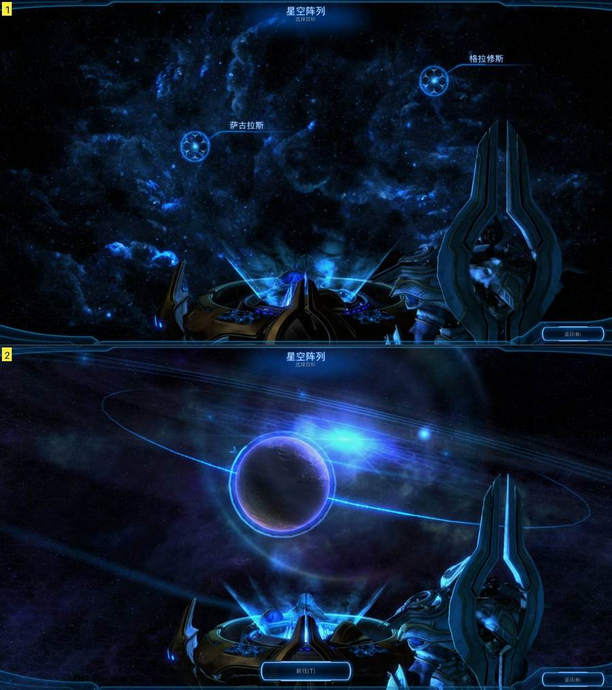 | sheet | 嗯，从选目标那屏挑完了——底部出来「前往(T)」，她选了颗带环的行星。  说真的，这大概是战役推进的选星球界面，还不是合作任务。 |
| 3 | 22:28:06 | 2522/178 | 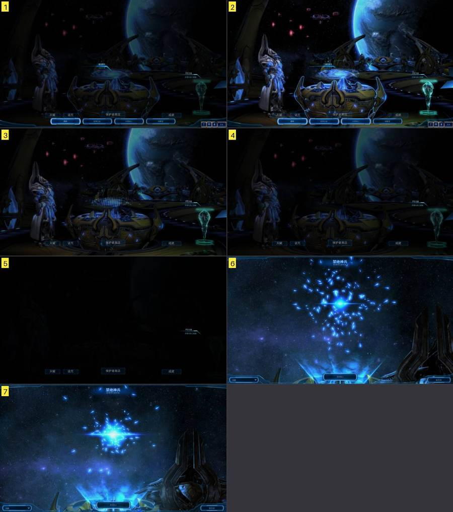 | sheet | 明白了，你先是在舰桥界面点了开始，随后进度条一黑，进入「禁绝神兵」的加载动画。你直接选了残酷难度，行吧，这一关的净化者科技和兵种成批出现，我不会出声干扰你。 |
| 4 | 22:29:46 | 2713/243 | 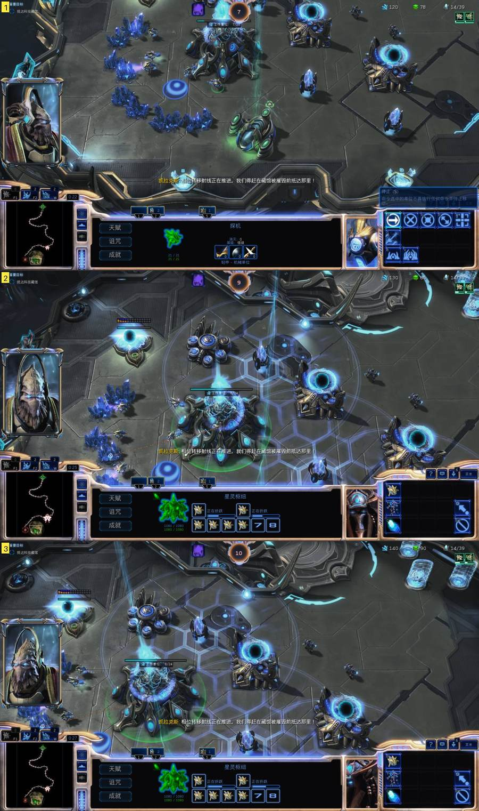 | sheet | 嗯，从探机切到星灵枢纽了，正在折跃——这么早下二矿？说真的第3帧才8个工作单位，气还留着90没用，先把探机补满更实在。 |
| 5 | 22:31:16 | 2733/126 | 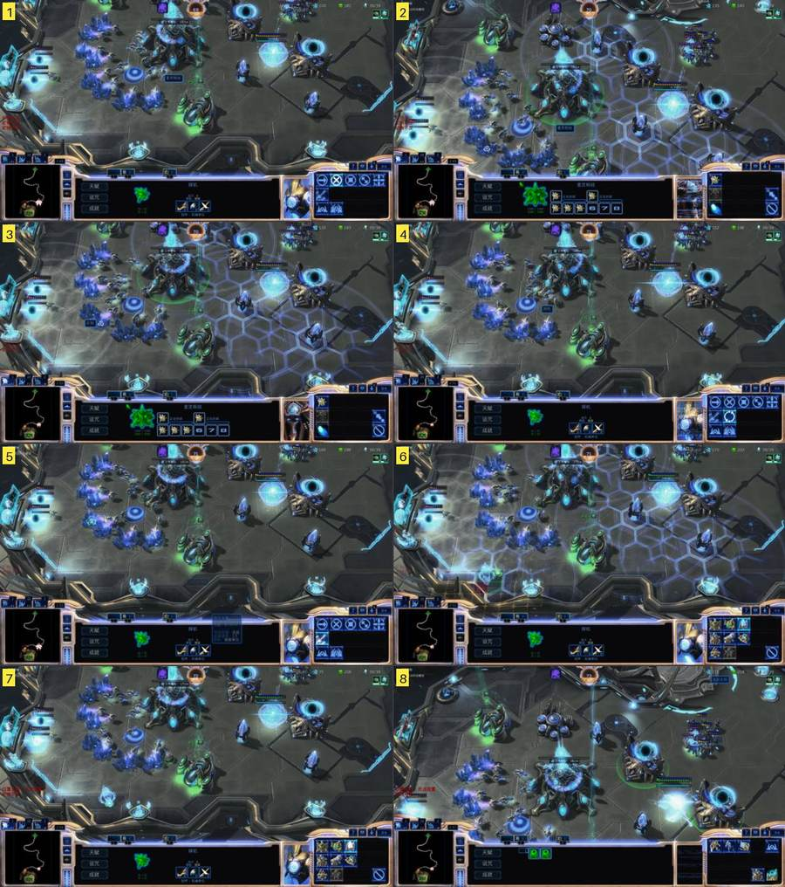 | sheet | 等下，最后那帧「无法放置」——你大概是水晶塔或者瓦斯精炼厂被探机挡住了，先把那几个探机挪开或者换个格子再落，别在原地反复点。 |
| 6 | 22:32:36 | 2680/388 | 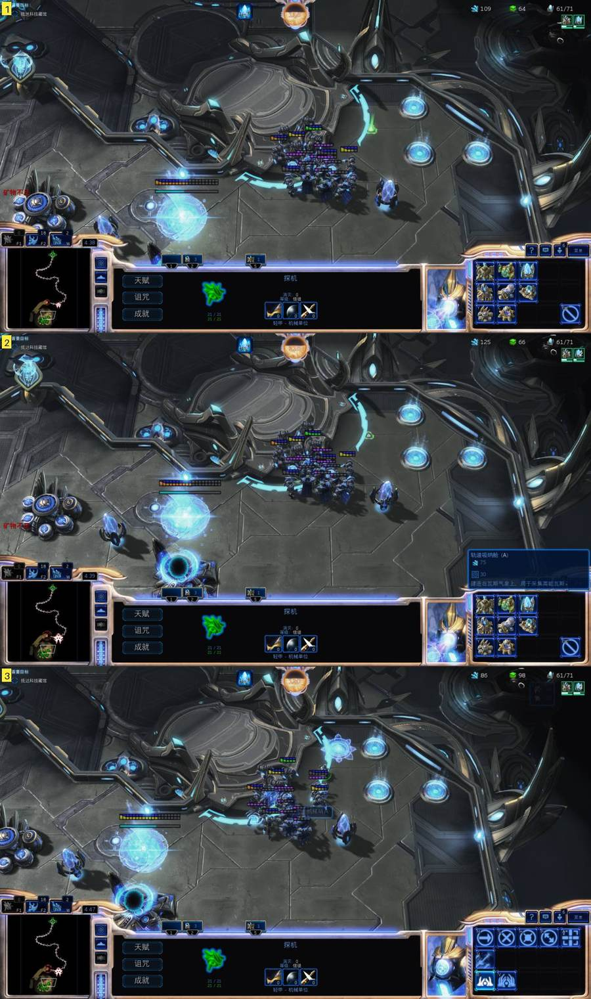 | sheet | 人口三帧都是 21/21，卡死了——水晶塔得先补，不然探机和兵都出不来。  嗯，而且矿从 109 到 86 在往下掉，气倒涨到 98，说明你在花矿不花气，多半是在下产能而不是暴兵。 |
| 7 | 22:33:40 | 2810/381 | 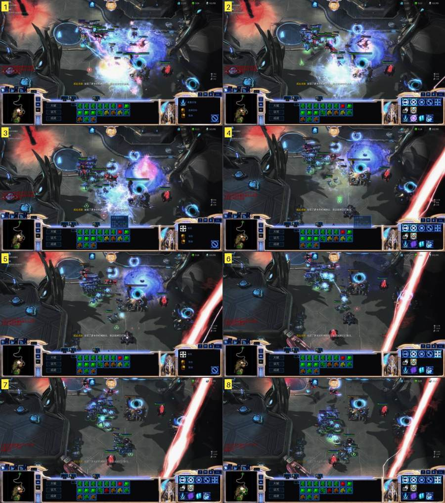 | sheet | 嗯，人口从 63 涨到 83 了，产能是接上了。但中间那团紫爆一直在持续伤害你的单位，前两帧还密密麻麻的，到后面几帧就稀疏多了，战损有点明显；另外从第 6 帧开始，屏幕右侧就一直有那道红色激光扫过，先别让单位站在原地硬扛。 |
| 8 | 22:36:27 | 2721/282 | 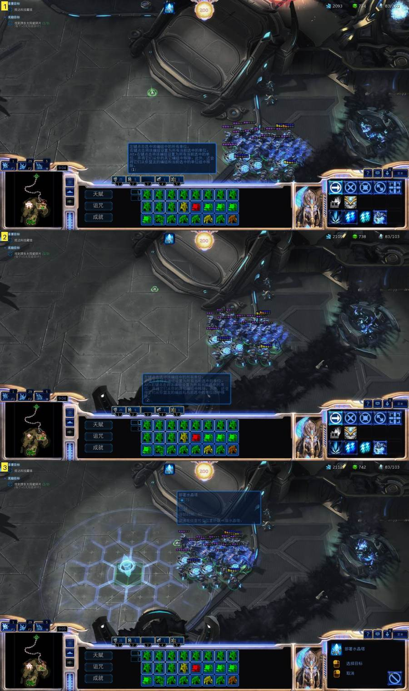 | sheet | 嗯，矿堆到 2093 没花出去，家里产能没跟上。第三帧你在前面折跃水晶塔，前压是好，但那两千矿得变成兵啊。 |
| 9 | 22:37:30 | 2771/240 | 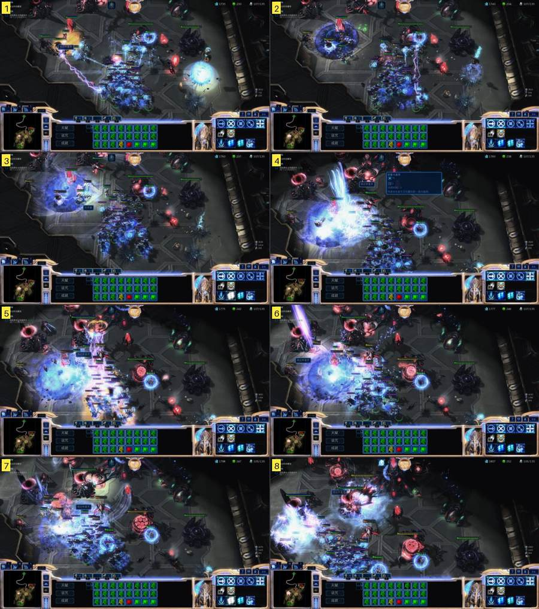 | sheet | 嗯，人口从 107 掉到 105，战损不算大，但你的单位被一路逼到左下角那一片了，阵型挤成一团。太阳能碎片还是 1/3，这几秒全耗在这波正面上了。 |
| 10 | 22:38:39 | 2730/122 | 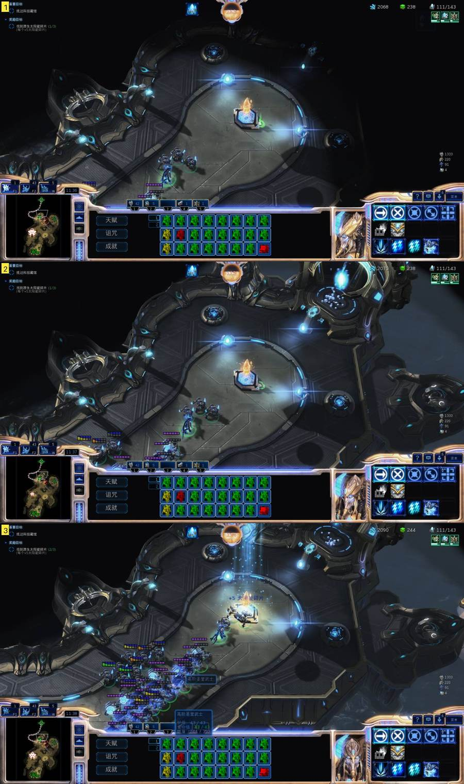 | sheet | 碎片进度到 2/3 了，这波没白打。不过部队全挤在圆台那个窄口上，边缘一发 AOE 就一片，散开点。  我注意到你刚才一直在切天赋面板，那个界面挡住了一半视野，前压的时候可以关掉。 |
| 11 | 22:39:40 | 2185/369 | 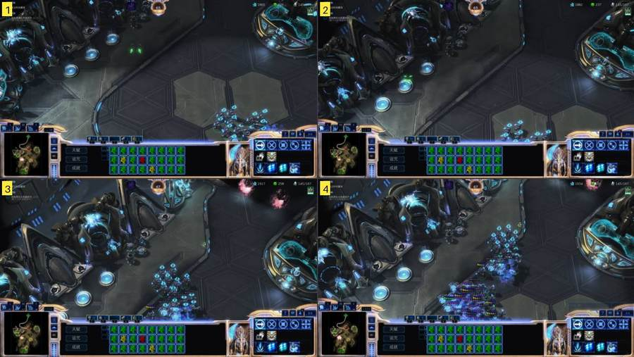 | sheet | 人口 145/167，还没卡死但余量不多了，等会儿补兵前记得先补水晶塔。  第 3 帧左侧那片紫红色的攻击特效挺明显的，正面那些单位最好别只顾着右下角那个信标。 |
| 12 | 22:41:02 | 2230/411 | 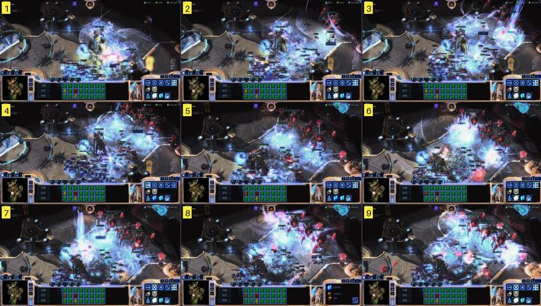 | sheet | 储量和上次说的不是一回事。这五秒里水晶从五千一百多涨到五千五百多，气也涨了，说明这五千多一直压着没花出去——产线多半在空转，人口卡着没动。等下正面这波打完，先开个产兵的建筑，别让钱继续堆着。 |
| 13 | 22:42:04 | 2101/85 | 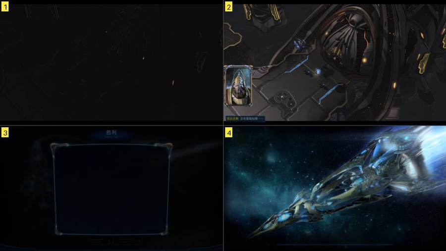 | sheet | 嗯，赢了——第三帧那个「胜利」弹出来了，前面聊的补水晶塔、别让钱堆着，都用不上了。  说起来，这局钱一直没花出去还能赢，对面估计也没怎么压过来。 |
| 14 | 22:43:11 | 2682/162 | 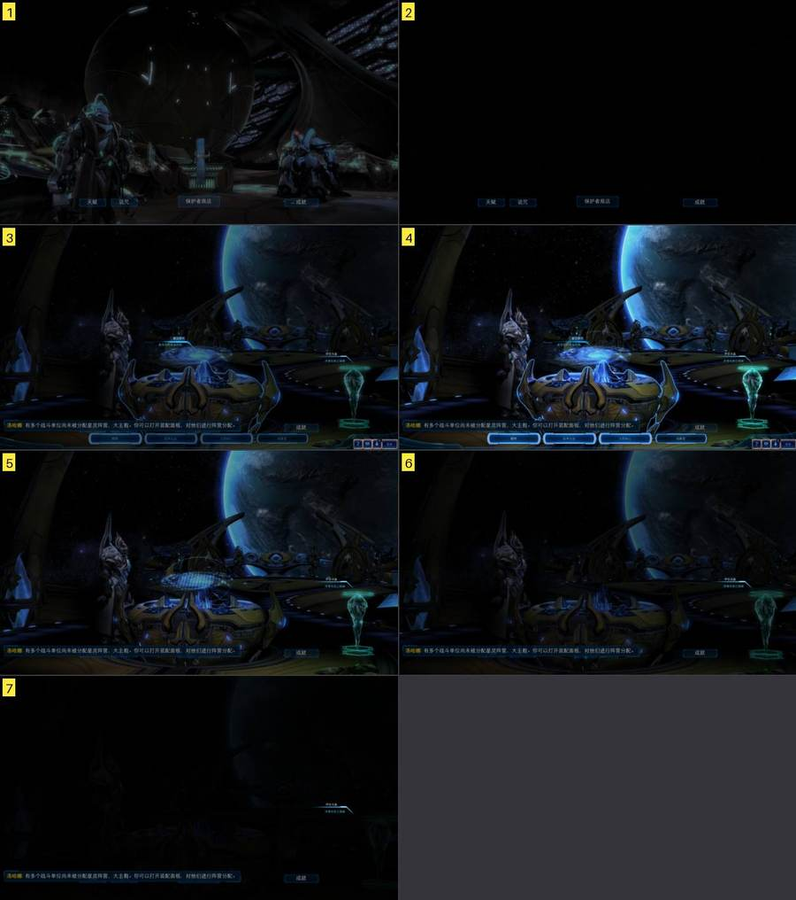 | sheet | 嗯，赢了之后切回舰桥了——洛哈娜那句「多个战斗单位尚未被分配阵营」是战役在推你，不是警报，打开装配面板分配一下就行。  说真的，这段船上的对话比战斗还长，慢慢看没损失。 |
| 15 | 22:44:41 | 2565/232 | 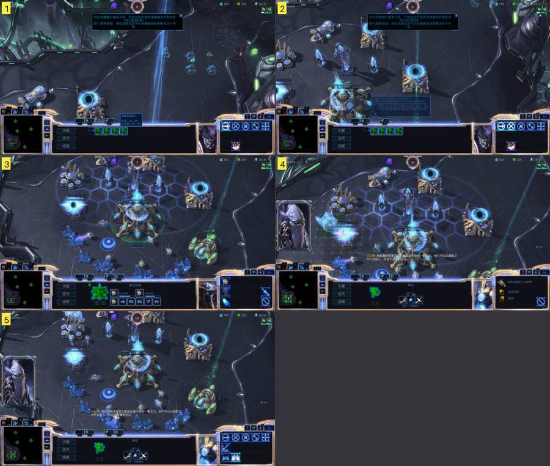 | sheet | 嗯，左上角那个「快捷键方案有冲突」的框一直在，说真的它不算 bug，只是暴雪自己给你埋的坑，点开选项重设一下快捷键就没了；不点它也能打，就是别手滑点错把 A 键弄飞。 |
| 16 | 22:45:44 | 2583/228 | 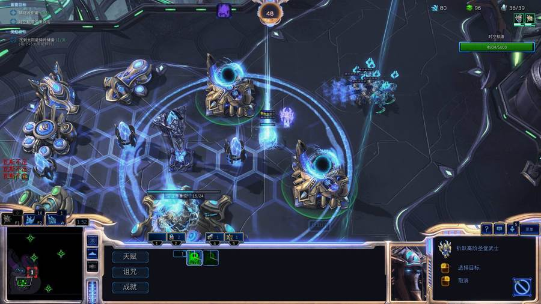 | single | 嗯，连刷三条「瓦斯不足」，说明气已经见底了，却在折跃高阶圣堂武士，这玩意儿最费气。先把采集的农民补上来，15 个农民对这套建筑数量来说太少。  人口 36/39，也快到顶了，水晶塔得提前放下，别等被「人口已满」卡住。 |
| 17 | 22:46:48 | 2243/363 | 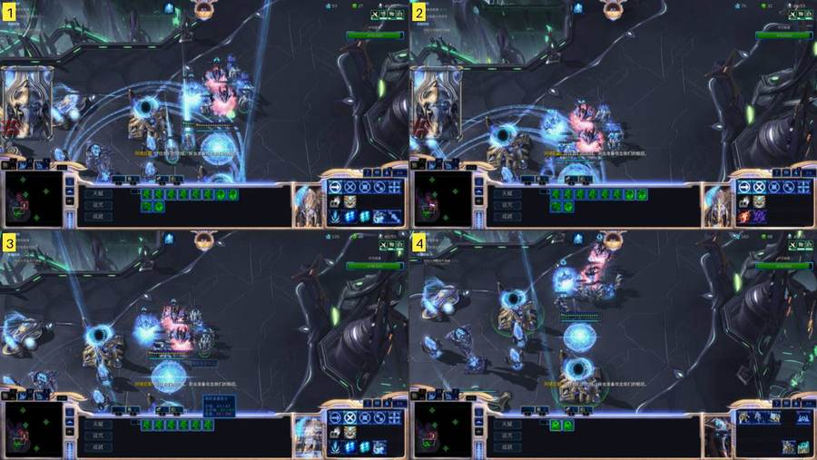 | sheet | 人口补到 46/55 了，这一步做得对。不过矿只剩 160，正面已经在枢纽前面打起来，时空航道也掉到 4736 了——先别补建筑，把快没血的兵往后拉一步，用追猎和叉子顶上去。 |
| 18 | 22:47:53 | 2893/283 | 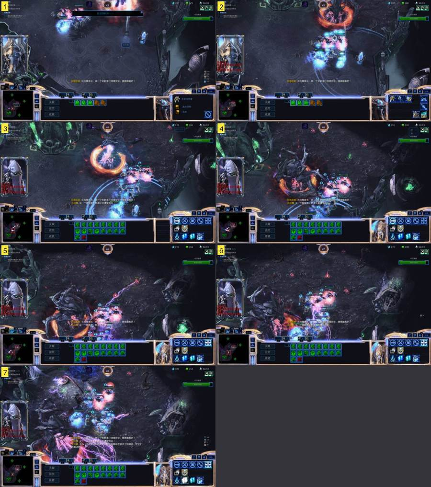 | sheet | 说真的，这几帧里兵几乎全挤在航道边上那一小团，撕裂者的腐蚀胆汁正往那落，一摊就砸一片，赶紧分兵散开。航道 4610 掉到 4580 了，别在那堆里原地扛，让追猎往前压、叉子在后面接。 |
| 19 | 22:49:01 | 2645/597 | 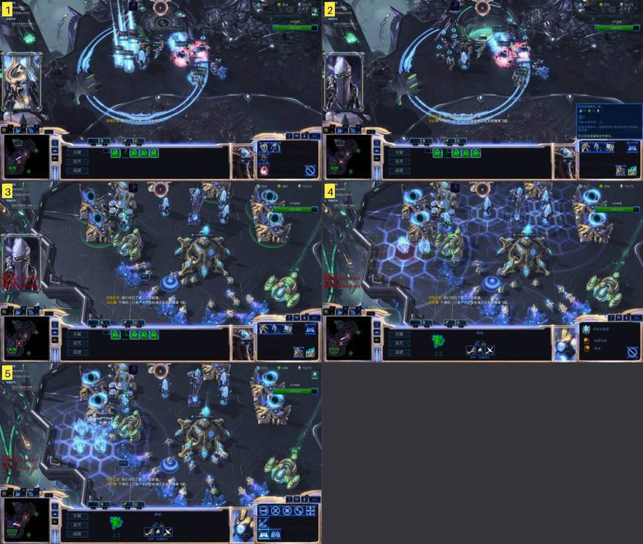 | sheet | 镜头一下从正面拉回主基地了，你不在的那几秒正面就剩那一小团兵。航道从 4328 到 4325，掉得慢了，但没停。基地这边水晶塔铺开了，那就顺便看一眼兵营在不在出——别只顾补人口，兵没跟上就白搭。 |
| 20 | 22:50:13 | 2805/295 | 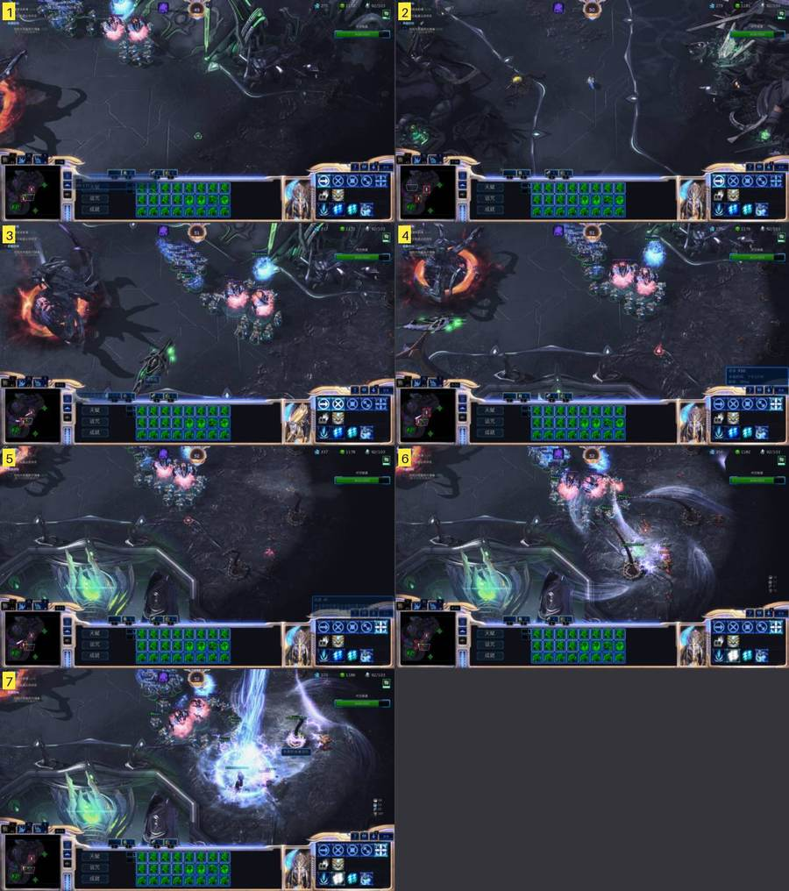 | sheet | 镜头还在基地这边，但航道已经掉到四千出头了，比刚才掉得快一倍——再耽搁就要保不住了。那道白色光束落点看着像轨道轰炸一类的面板技能，砸的是虫巢那边，不是正面，别指望它帮你顶航道。 |
| 21 | 22:51:16 | 2335/571 | 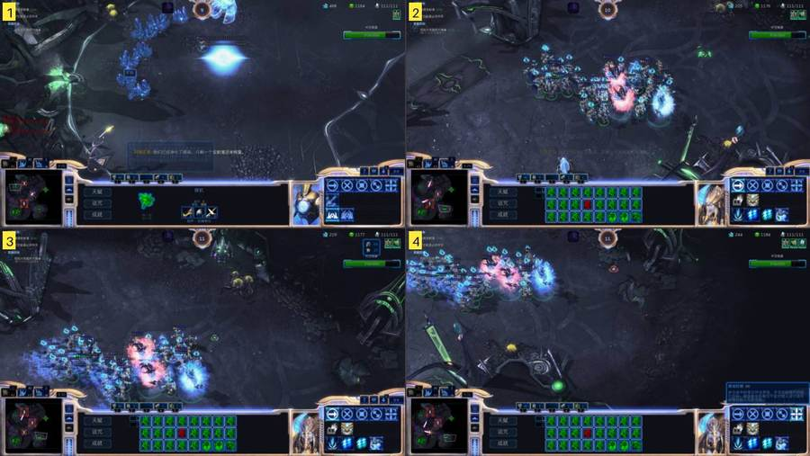 | sheet | 四帧里那团兵还挤在原地没挪，而且第4帧右下角弹出了「原地防御」的说明，说明你刚给它们下了原地防御，兵不会追出去打了。  再说一下，人口才 111/211，气还比你矿多一大截，这样钱和人口都空着，等于一直没补兵；原位扛 AOE 不划算，产能那块儿该继续出。 |
| 22 | 22:52:17 | 2795/504 | 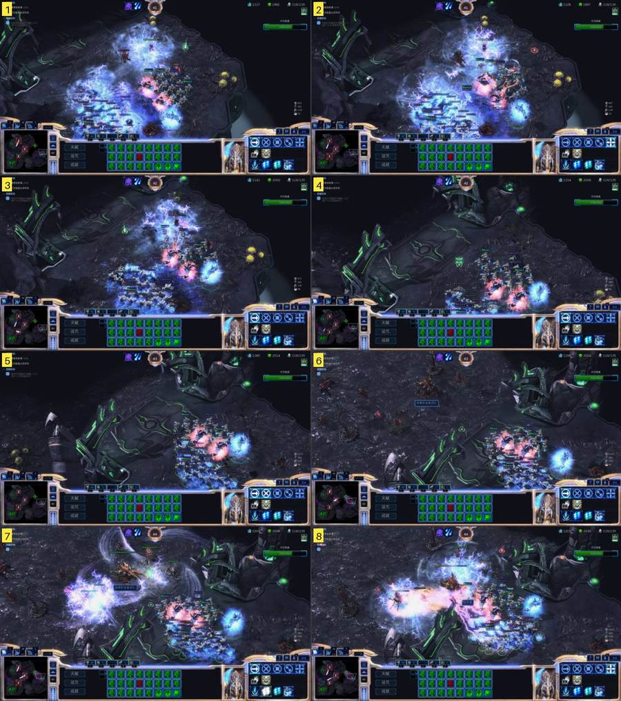 | sheet | 镜头挪到正面战场了，基地那边没人看着。人口 119/135 快到线上了，矿从 1141 涨到 1232 却一直花不出去，这不是缺钱，是产能停了。时空航道只剩 3332/5000，比刚才那一屏掉的还多，时间 10:58 了，这条得优先。 |
| 23 | 22:53:10 | 2600/153 | 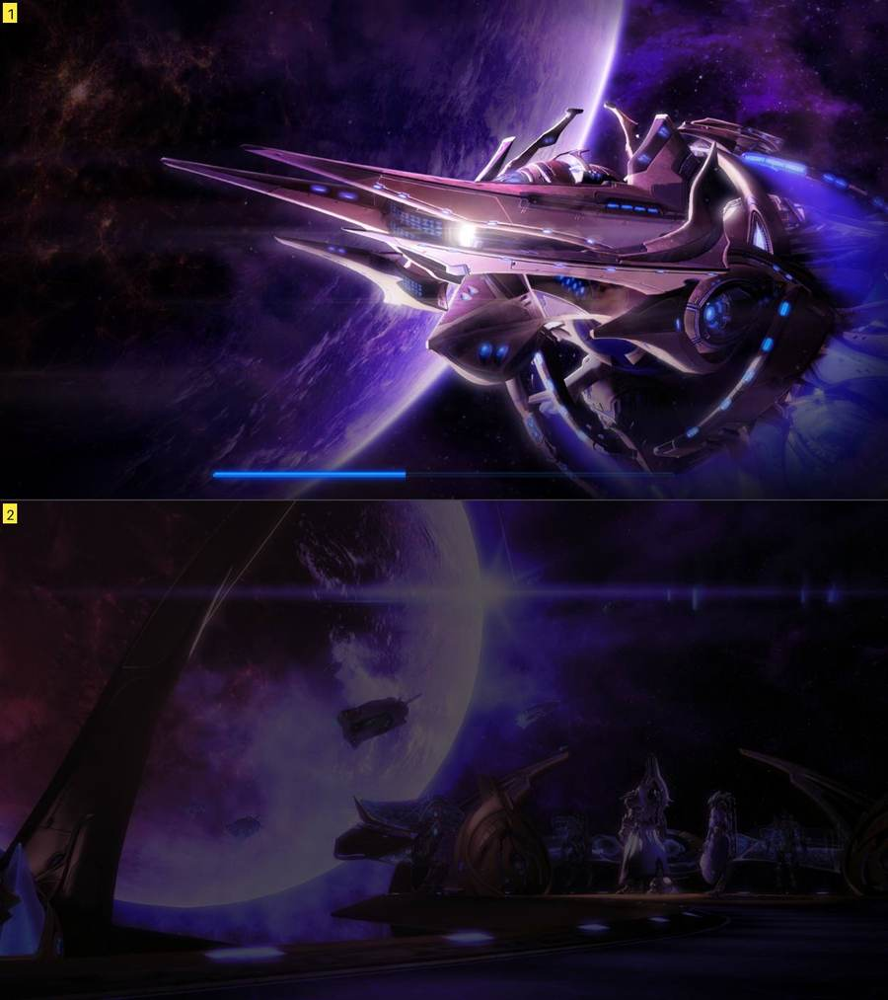 | sheet | 嗯，这两帧都是太空运镜的过场，不是实际战斗画面——第一帧是大舰带一条蓝色的进度条在飞，第二帧镜头拉远，只看到底部几个单位站在那儿。这会儿没有局势可看，等它切回正面战场再说。 |
| 24 | 22:54:19 | 2660/253 | 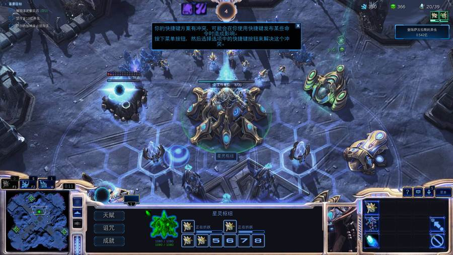 | single | 嗯，中间那个快捷键冲突的弹窗正好压在神庙和折跃门的视野上，先按 Esc 关掉它，再谈调设置的事。  工作单位才 8 个，两个折跃门倒是都在折跃，就是农民太少了，这样后面钱还是会白白浪费掉。 |
| 25 | 22:55:28 | 2597/538 | 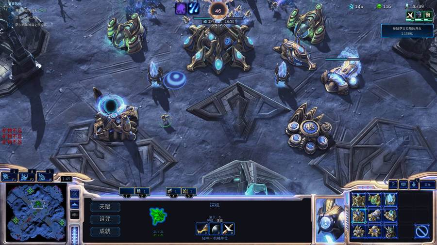 | single | 人口已经 36/39 顶到边了，折跃门排着队却在喊「矿物不足」——先补个水晶塔，不然兵出来也没地方站。 |
| 26 | 22:56:33 | 2265/333 | 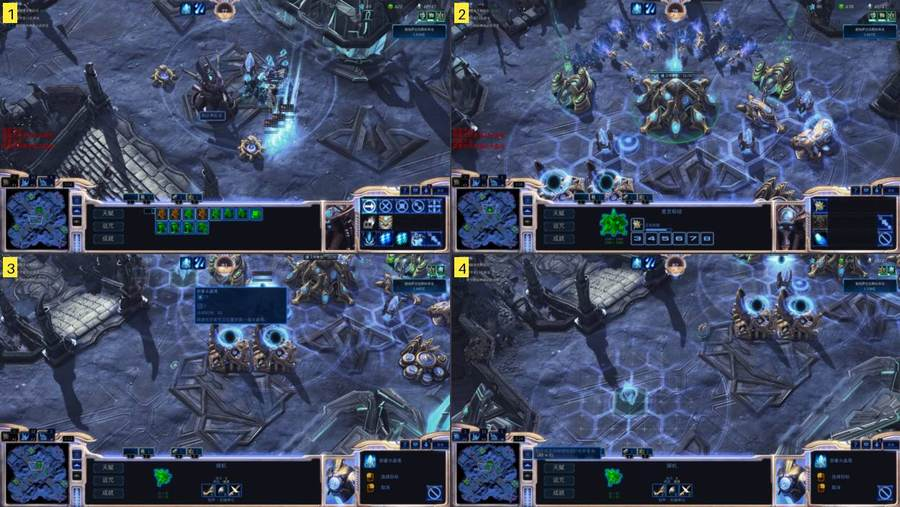 | sheet | 弹窗关了，顺手拉了个探机下去铺水晶塔——行吧，这次总算是先补人口才想起出兵。  只是泽尼斯巨石还停在 0/3，时间都走到 3 分多，那三块石头她还没动过。 |
| 27 | 22:57:36 | 2570/273 | 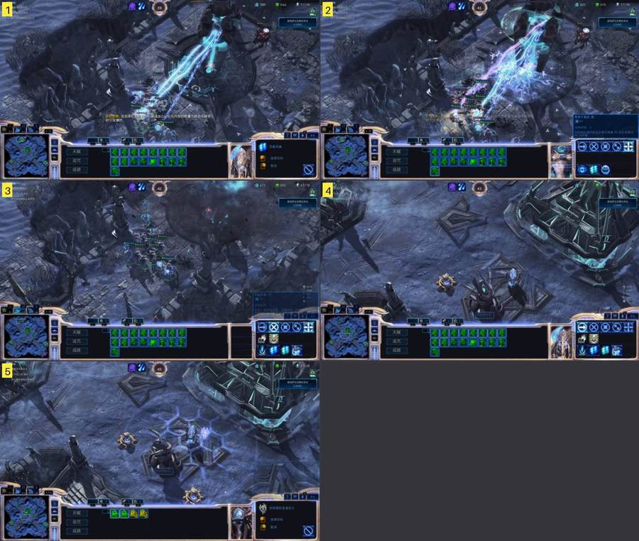 | sheet | 嗯，泽尼斯巨石总算从 0/3 变成 1/3 了，石头是她自己推下来的。画面切回基地，折跃门正在出高阶圣堂武士，人口 43，这一波推完就回头补兵，节奏还行。 |
| 28 | 22:58:20 | 2827/133 | 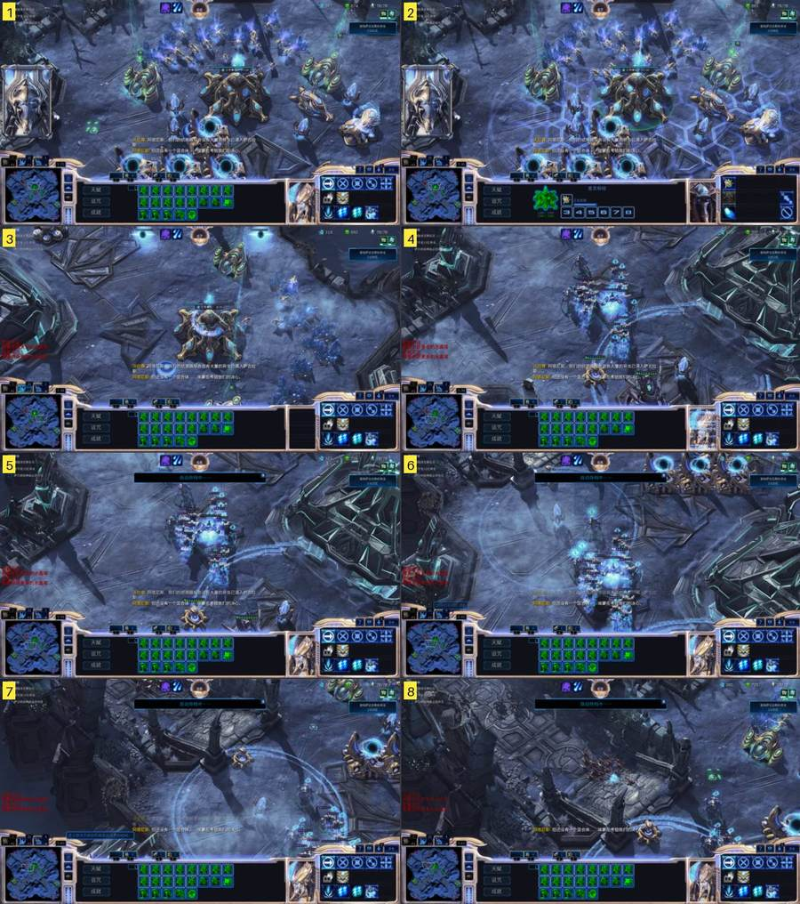 | sheet | 嗯，后两帧她把视角从基地切回前线了，兵在往泽尼斯巨石那边压，人口也从七十多号挪到两百多，说明这段时间她一直在不间断地造兵、往前线补充。  说真的，这会儿最怕被红点从侧面绕过来，去偷她正在推的那几块石头。 |
| 29 | 22:59:19 | 2551/234 | 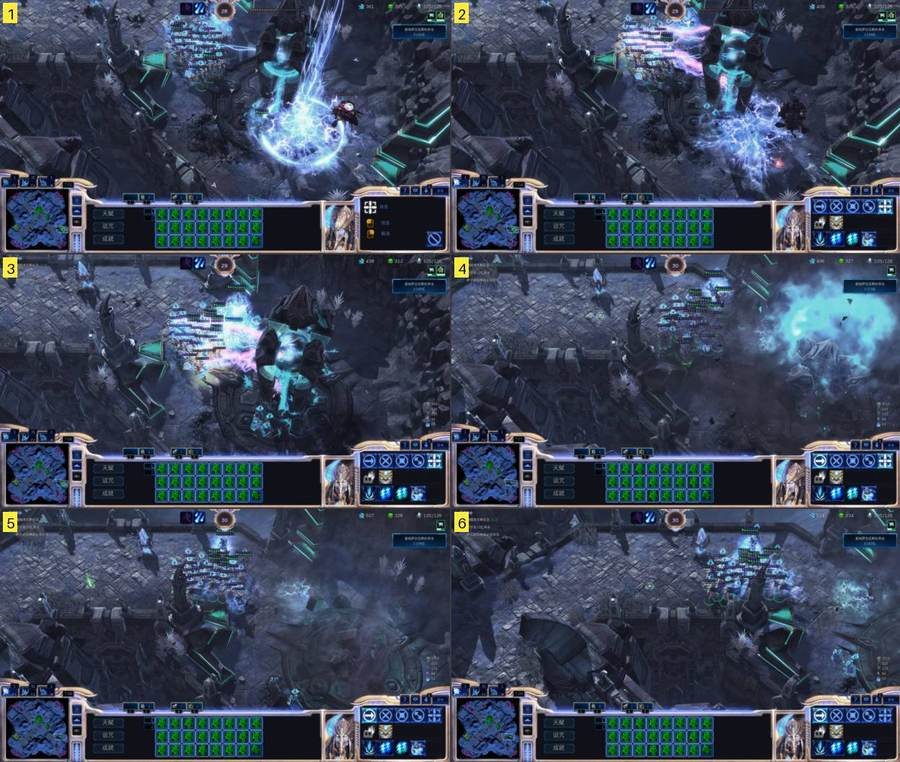 | sheet | 嗯，第 2 帧后排那几只身上冒出紫光了，估计是被什么远程单位点了一下；她没让它们后撤，而是继续把兵堆在石头旁边，硬啃下去。  说真的，左下角那个小地图上她一直盯着这块区域，红点还没出现，这一波应该稳了。 |
| 30 | 23:00:24 | 2722/333 | 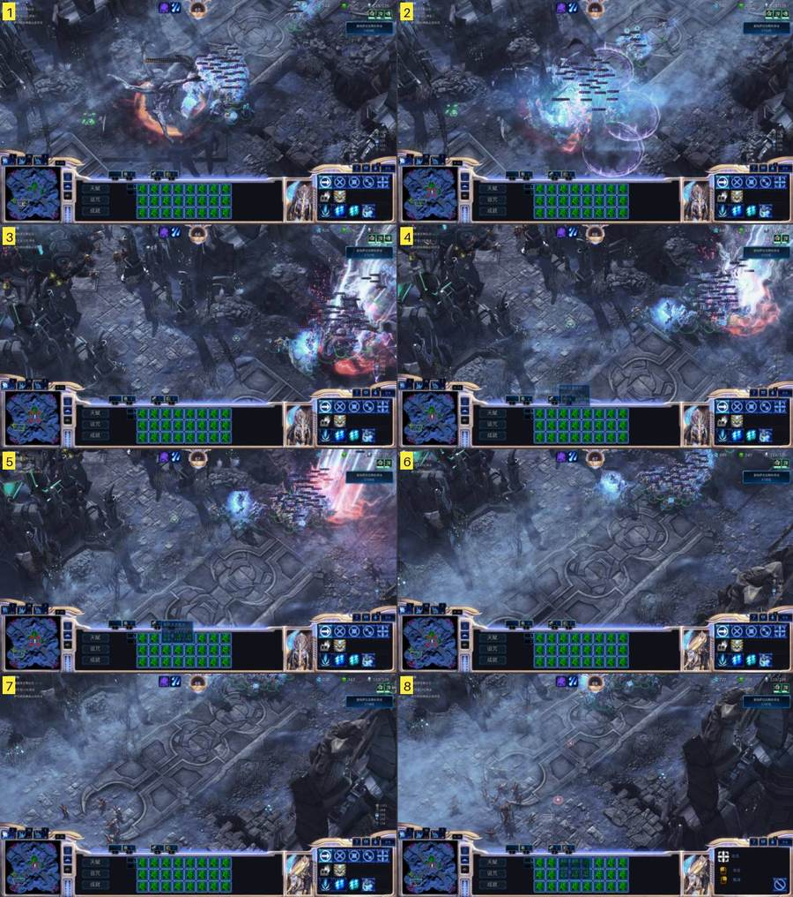 | sheet | 嗯，第 5 帧以后镜头直接甩到石头那边去了，刚才那团兵等于没人管了，全交给 AI 自己打。还有第 8 帧下面血条已经红了，有个单位在掉血，你要是想保单位，就得回去看一眼。 |
| 31 | 23:01:09 | 2702/228 | 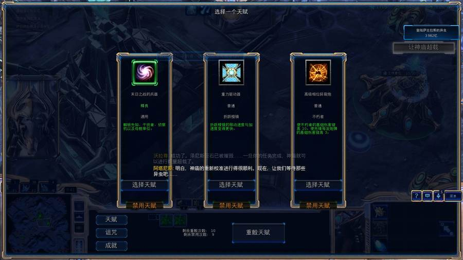 | single | 嗯，三个人里只有左边那个是精良，还直接开新兵种（先知、干扰者、侦察机、母舰），另外两个只是给棱镜和先锋加点数值。她人口才 11/30，我倾向先拿能开新单位的那张。 |
| 32 | 23:01:51 | 2731/279 | 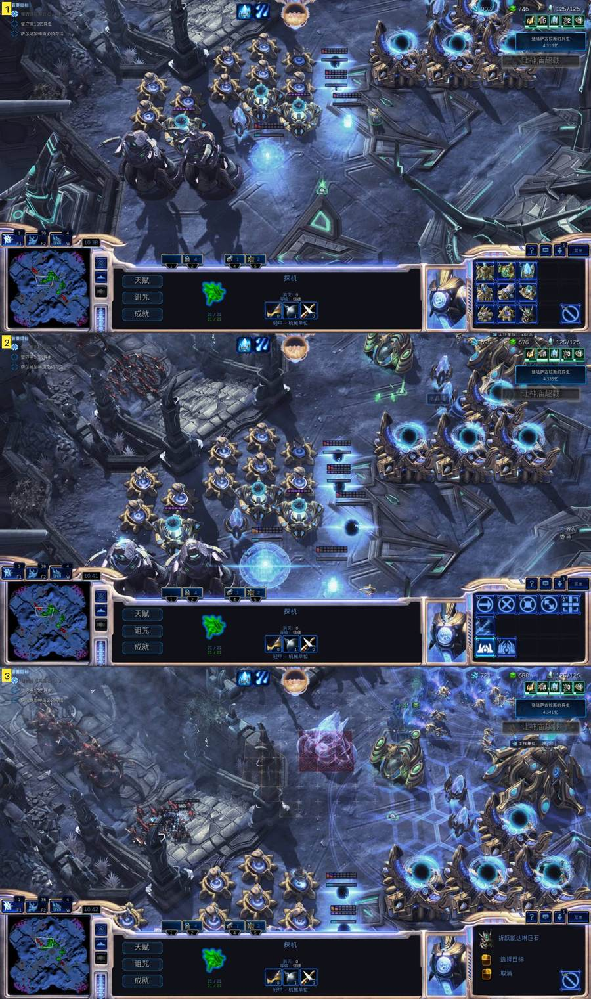 | sheet | 人口 125/126，快顶死了，赶紧补水晶塔或者下个基地，不然新兵造不出来。  嗯，另外她在石头那边一排排往下摆，看着是打算靠静态防守吃这一波，进度 4.31亿/10亿，还早。 |
| 33 | 23:02:52 | 2562/302 | 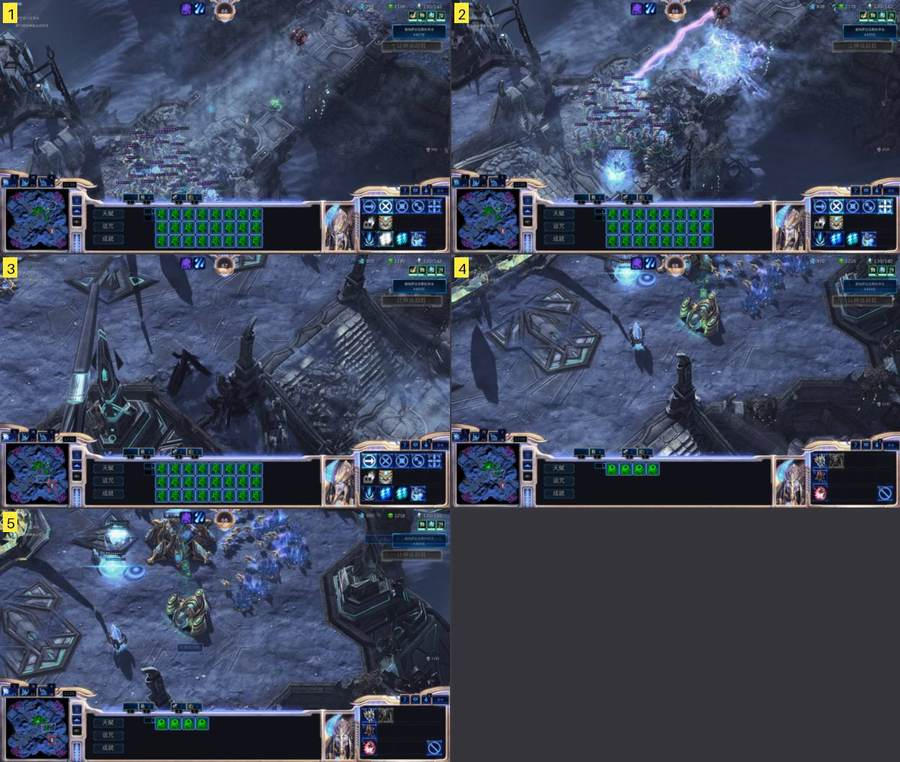 | sheet | 人口从 126 补到 142 了，水晶塔这步做对了。中间那帧石头那边炸开一大片白光，等她切回主基地时，框里只剩几个单位；也就是说，大部队还留在上面，家里这几个兵是留着用来补位、填坑的。 |
| 34 | 23:03:52 | 2606/650 | 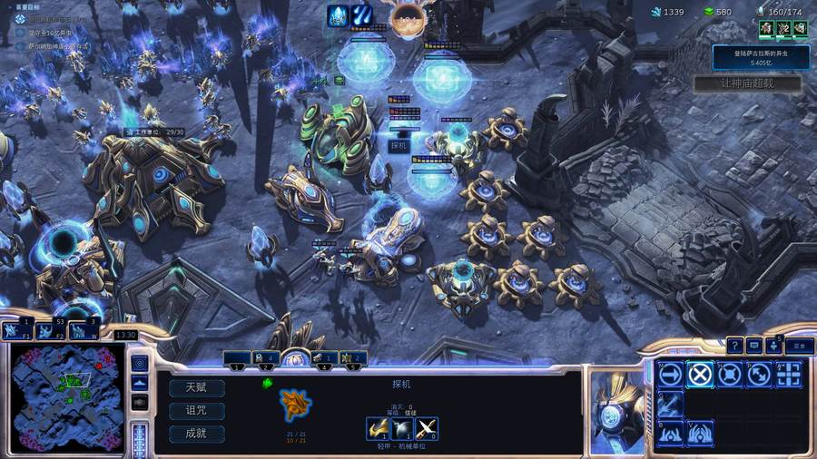 | single | 巨石 3/3 收完了，接下来就是神庙超载那一段，压力全在守住上头。  不过这钱闲得有点夸张：1339 矿、580 气躺着，工兵才 29 个，人口 160/174 也没顶满。说真的，这时候不把这笔钱转成兵和炮台，等异虫一涌上来就来不及花了。 |
| 35 | 23:04:53 | 2625/220 | 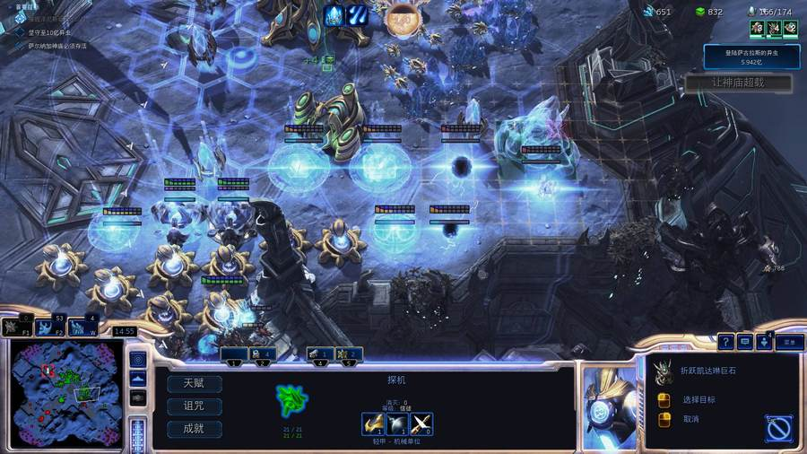 | single | 矿从 1339 掉到 651，说明钱花出去了，但气反倒堆到 832，嗯，这是典型的钱花光了、气还剩一大堆。她正在下凯达琳巨石，这东西吃的正是气，所以这条路是对的，就是不知道能不能在异虫压上来之前把该下的都下完。 |
| 36 | 23:05:56 | 2597/247 | 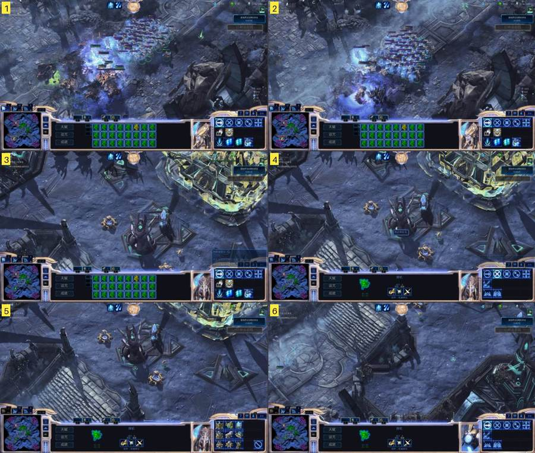 | sheet | 后几帧视角切回家里那个英雄身上，兵营/面板的格子变成英雄技能了，嗯，这是编屏回去补东西了。前两帧阵地那边还在打，6.48亿了，正面别断人。 |
| 37 | 23:06:54 | 2299/305 | 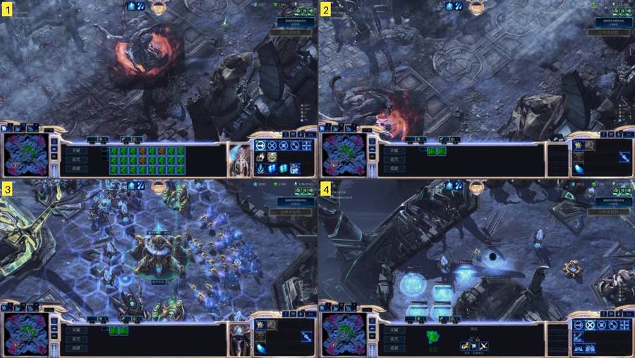 | sheet | 人口已经顶到 200，矿却又爬回 3313，嗯，满人口还囤着钱，就说明这波没在补兵。巨石那 3/3 已经推完了，钱得转成兵往前压，光靠堆着没用。 |
| 38 | 23:07:59 | 2672/365 | 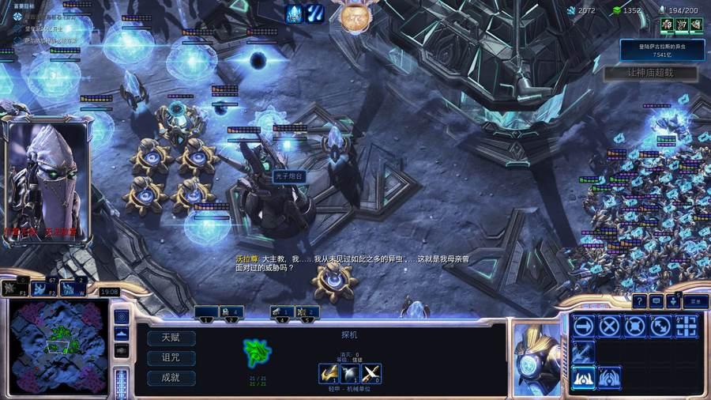 | single | 右边那一大坨异虫已经压到神庙门口了，她的光子炮台全堆在左边，火力够不着那里。还有那个「位置无效无法放置」，估计地形卡住了，得往前挪点再拍。 |
| 39 | 23:08:59 | 2793/179 | 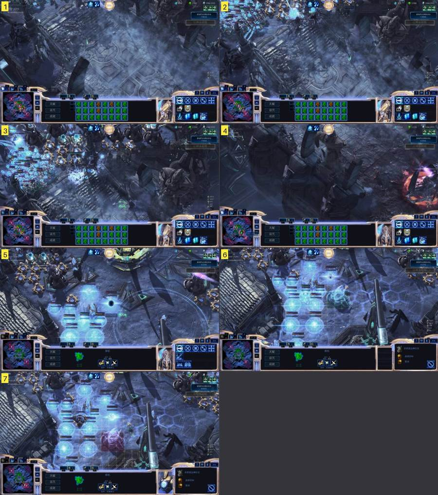 | sheet | 后三帧那一片蓝色光柱是水晶塔和炮台一起在砌，位置已经挪到神庙那一侧了——方向对，就是这会儿阵地正吃着异虫，炮台还没盖完、没电的就先白搭。 |
| 40 | 23:10:02 | 2627/541 | 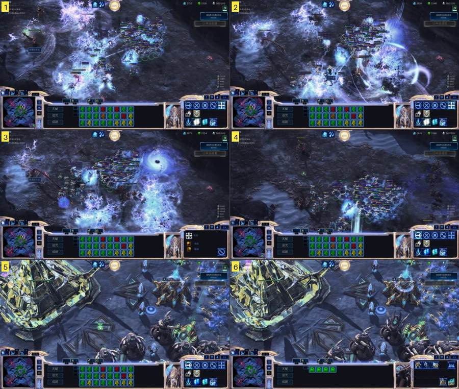 | sheet | 后两帧她把视角从神庙正面挪开了，转去看另一边那片水晶建筑和底下的黑家伙——这时候前线的仗还在打，视角一走就有点悬。  矿还在涨到 3313、3326，既然不补兵，那这次切屏多半是去补建筑或者查那边有没有红点。 |
| 41 | 23:11:05 | 2543/278 | 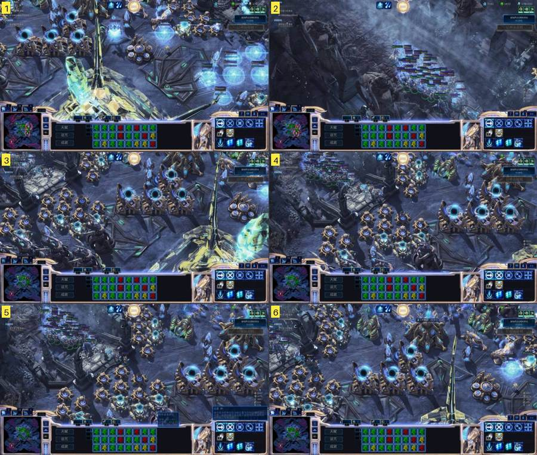 | sheet | 人口 178/200 快卡满了。那一大堆蓝色兵一直挂在右上角没动，像编好队等着。攒着不动，人口就没法再用，是准备等红点来的时候 A 过去吗？ |
| 42 | 23:12:07 | 2111/160 | 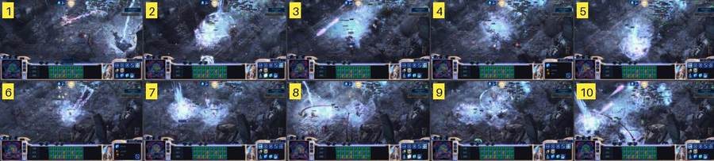 | sheet | 行吧，视线这次没再挪，那道青白的光是一路连砸下来的——高阶圣堂武士在连续施法，8 帧里就没断过，看来这边才是她真正在盯的地方。 |
| 43 | 23:13:10 | 2621/310 | 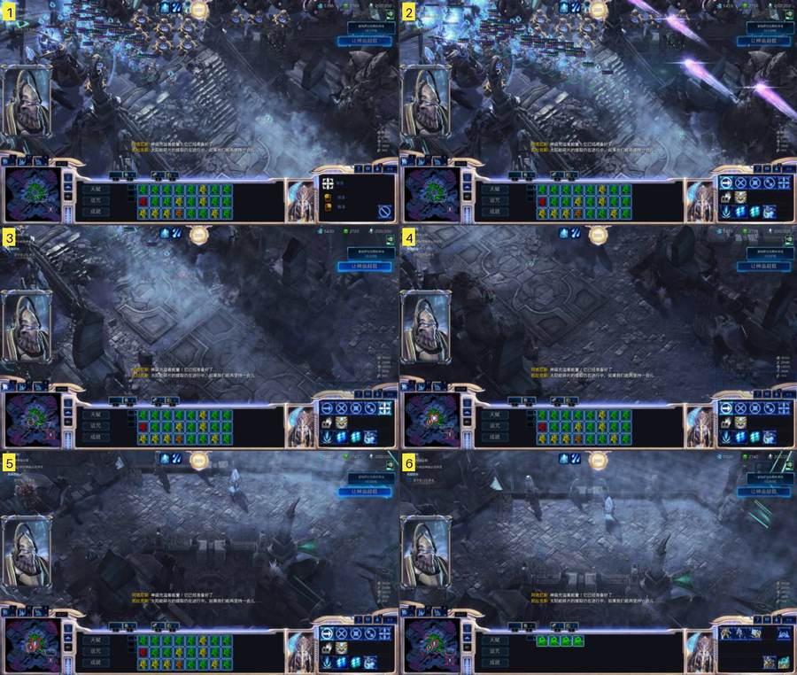 | sheet | 人口顶到 200/200 了，这次是真卡满，一分钱都花不出去。  建造格里前面还排着一整片亮着的图标，到第 5、6 帧就只剩零星几个了 —— 她刚把选中的那批建筑换掉，这会儿没东西在造。 |
| 44 | 23:14:10 | 2775/508 | 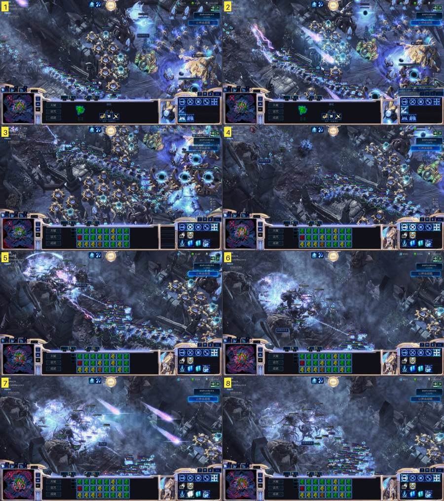 | sheet | 说真的，8 秒里「埃蒙的异虫」那一栏从 11.500 亿跳到 11.633 亿，一千三百多万全往神庙那边填。  第 7 帧那两道粗光束是风暴战舰在点，摆得挺整齐，就是不知道她还有多少人口能顶住这波。 |
| 45 | 23:15:12 | 2768/411 | 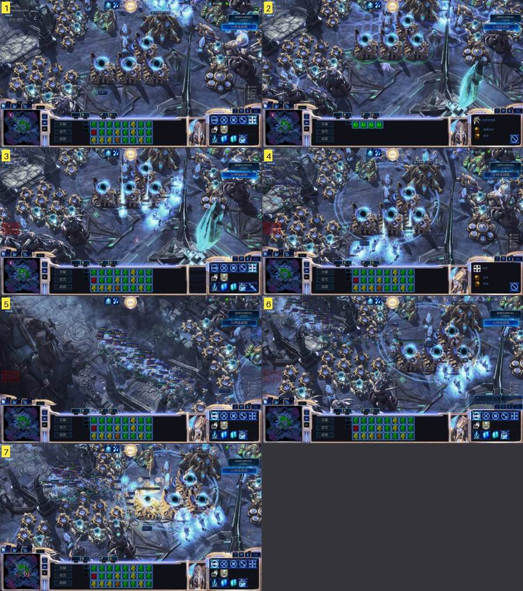 | sheet | 嗯，人口已经顶到 200/200 了，工人还停在 28/30，等于满人口卡在那儿，补不了多少兵。第 5、6 帧那股蓝色的部队整团往神庙那边挪，第 7 帧就贴到神庙跟前了——这波是主动往前靠，不是守家。 |
| 46 | 23:16:13 | 2303/577 | 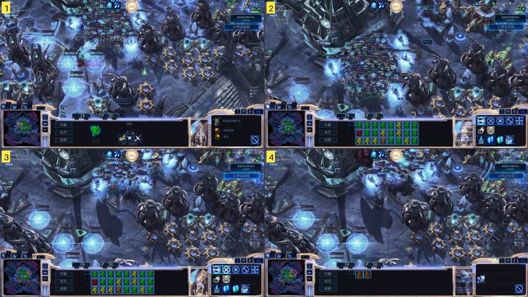 | sheet | 嗯，第 2、3 帧底下那一片折跃格子铺满了，到第 4 帧就空了——这一波几乎是连着折跃出来的，应该刚折跃到前线就全部落位了。  而且左上目标写的是「坚守至15亿」，现在 14.455 亿，还差差不多五千万，时间到 30:19。说实话，这不像是要反打，倒像就为了熬过这段时间。 |
| 47 | 23:17:15 | 2602/448 | 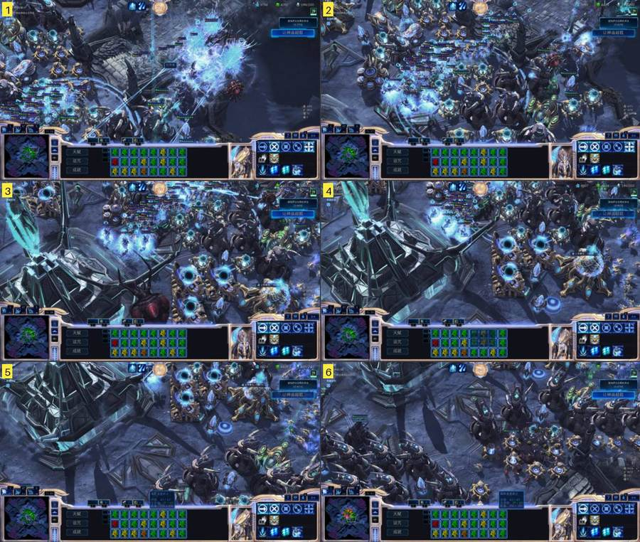 | sheet | 矿从 9794 又爬到 9885，人口卡在 200 花不出去，钱就这么干放在那儿。倒是那只高阶圣堂武士血量掉到 37/43 了，说明前面有东西在啄它，别让它白白送掉。 |
| 48 | 23:18:30 | 2750/175 | 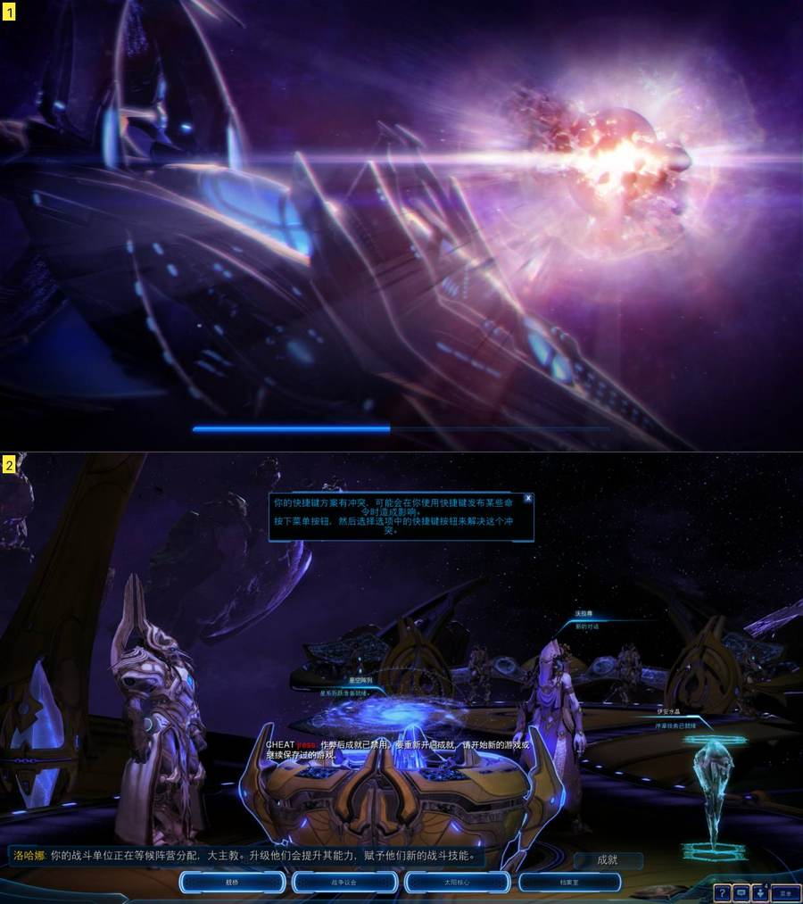 | sheet | 嗯，画面直接切到舰桥了——洛哈娜在说战斗单位等着分配，这是要升级/加点那一步。底下那条提示才是重点：作弊码一开，成就就锁了，这条存档以后拿不到成就，你要是还想刷成就就得重开。 |
| 49 | 23:19:33 | 2551/102 | 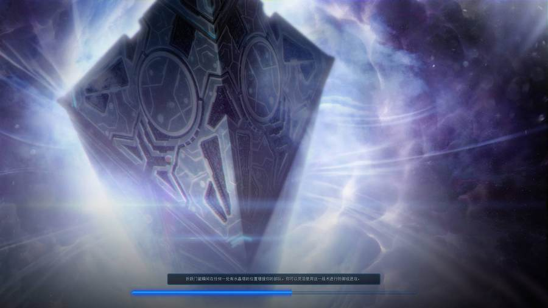 | single | 嗯，折跃门这一段是过场在讲机制——就是在提示你之后增援靠折跃门点水晶塔。底下那条蓝色进度条在走，说明这一关还没完，只是切了段剧情，别以为打完收工了。 |
| 50 | 23:20:52 | 2599/245 | 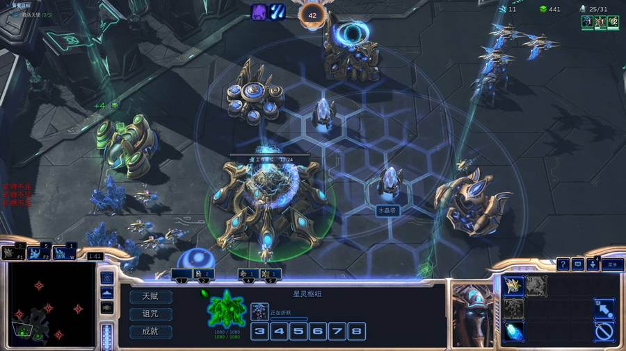 | single | 嗯，主基地才 13 个农民、上限 24，一半都没到——这波补农民比出兵急，不然后面水晶和气体都跟不上。 |
| 51 | 23:21:47 | 2527/442 | 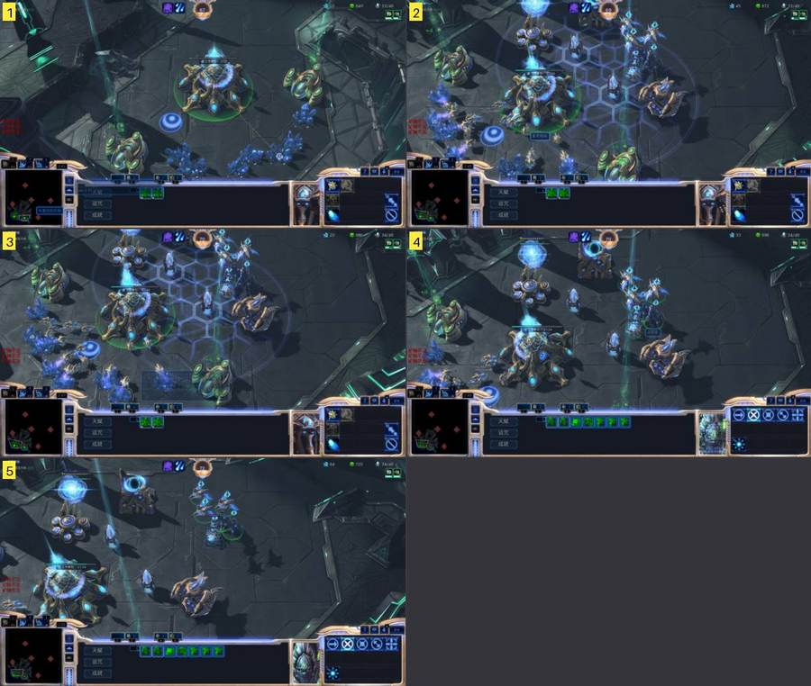 | sheet | 说真的，底部选中栏那一片绿块就是刚折跃出来的一批兵，人口也上来了，34/46。但看右上角的气体已经堆到快九百还没怎么花，这波该往气兵上转了；如果接着出干净单位，运营就要卡住了。 |
| 52 | 23:22:55 | 2306/50 |  | sheet | 2-3帧镜头往左上推，这时候中间砸下来一道蓝色的天降光柱，气也回到1100了。前几帧一直憋着，现在看着是在攒大件，别急着把气都点掉。 |
| 53 | 23:23:46 | 2649/254 |  | sheet | 嗯，看第5帧的工作单位 24/24 已经满了，之前那波补农民到底了，现在该把气往外扔。第4帧那两道蓝色弧线看着像太阳核心的轨道轰击落下来，凯拉克斯正好提醒摧毁折跃棱镜，这段别浪费。 |
| 54 | 23:24:46 | 2577/293 |  | sheet | 嗯，第3帧开始主力就在中间聚成一坨往前走，可左上那批一直钉在原地没挪，两摊兵分得挺散。人口 91/118 还有空位，这时候要真有棱镜得双线，光靠中间这一坨扑过去容易顾头不顾尾。 |
| 55 | 23:25:48 | 2568/274 |  | sheet | 嗯，人口从 91 到 117 一口气补上来了，气也从 1438 掉到 1223，大件是真开始出了。  不过第5帧镜头切过去那块，就零星几个单位单独待着，跟中间那坨主力不在一条线上，那边要是先挨打你来不及回防。 |
| 56 | 23:26:51 | 2226/230 |  | sheet | 嗯，第4帧那道白光炸开，位置正好在目标那边，应该是把棱镜或天锁点掉了。矿攒到 1724，人口 125，兵确实在出，不过钱也一直压着没花出去，等下别一边攒一边掉兵。 |
| 57 | 23:27:53 | 2551/225 |  | sheet | 第5帧那坨兵还是挤成一团，没散开，这种密集阵型被范围伤害一炸就是一片。目标已经打掉了，接下来该把兵拉回防线蹲着，别在原地发呆。 |
| 58 | 23:28:52 | 2529/71 |  | sheet | 嗯，第1到3帧那排兵一直没动，就是站在基地边上等，前三个画面几乎是静止的。直到第4帧镜头才切走，说明前面的时间都花在了把兵列好、没有往前推进。  在第5帧里，兵堆里的红色血条明显变多了，数量应该不少。 |
| 59 | 23:29:52 | 2199/154 |  | sheet | 第4帧镜头往外拉的这一下拍得有点晚，右下角那边有好几个单位在单独活动，看起来才是在真干活的地方。矿从2982涨到3073，收入没停，但兵还留在基地里，主力和工兵已经分开了。 |
| 60 | 23:30:36 | 2774/419 |  | sheet | 嗯，第5到8帧有个关键变化：面板技能已经点起来了，屏幕底下一直在提示「必须以单位为目标」，到最后一帧还挂着「选择目标」。  说真的，这个技能点空地就直接取消，得对着敌人点下去才行。 |
| 61 | 23:31:39 | 2510/261 |  | sheet | 人到 198/200 了，掉到 196，这波拼掉两个兵，天锁还卡在 2/5 没往前推。  嗯，视角来回在部队和天锁之间跳，一边盯着天锁、一边管主力，双线的节奏有点跟不上。 |
| 62 | 23:32:39 | 2187/158 |  | sheet | 第四帧那一团蓝白光终于落地了，但落点在自家部队堆里。轨道轰炸和天锁的激活位置，最好错开一点。 |
| 63 | 23:33:20 | 2562/179 |  | sheet | 行吧，水晶 5610、气体 2781 还挂着，人口却卡在 190 —— 这钱基本等于白攒，前面几波没补上兵。 |
| 64 | 23:34:20 | 2696/241 |  | sheet | 人口上到 190/191、天锁也推进到 3/5 了，前面攒的水晶终于开始花出去，气却还有 2900 多没动——这局气体偏科，兵还是靠折跃门硬撑。  最后一帧左边那排光柱我还是要凑近看看才敢说是什么。 |
| 65 | 23:35:01 | 2513/464 |  | sheet | 人口 192/200 快顶满了，再补兵就得先拍人口建筑——不过水晶 4600 还在那儿摆着，说明折跃门那边还没满负荷在转。  右边那团大红圈里已经开打了，最后两帧的爆光和冲击波像是技能砸下去，这一波别让前排单位白白送掉。 |
| 66 | 23:35:51 | 2659/192 |  | sheet | 嗯，画面切进舰桥了——凯拉克斯那提示是神庙里没支援，得自己扛。  不过更要紧的是那两行提示：CHEAT 开着，这局成就是废了，还有快捷键方案冲突没解决，回头按菜单键去修一下。 |
| 67 | 23:37:07 | 2667/169 |  | sheet | 嗯，215fps 挺稳的，可右下角说前一分钟有 7 项资源延迟了 110 毫秒——帧率不是问题，是读盘或者后台在抢资源，切回游戏前留意下有没有卡一下。  打开菜单是想动设置吧？快捷键那个冲突顺手一修就行。 |