# 余光陪看 · 杀戮尖塔 2 对照表

共 99 次唤醒，跨 132 分钟。截图按序号放在本目录（sheet=多帧拼图，single=单张全屏）。

**这 99 次的实际消耗**（每次的明细在下面表格的 token 列，格式为「未缓存输入/缓存读取/输出」）：

| 项 | token |
| --- | --- |
| 未缓存输入 | 171,806 |
| 缓存读取 | 37,760 |
| 输出（含思考） | 80,991 |
| 合计 | 290,557 |

缓存命中 18%，平均响应 6.7 秒。
尖塔的画面每帧都在变，前缀能对上的地方比看剧少，所以缓存这块比星际那局低得多。

| # | 时间 | token（入/缓/出） | 截图 | 类型 | 它说了什么 |
| --- | --- | --- | --- | --- | --- |
| 1 | 21:55:59 | 1765/128/262 |  | single | 嗯，刚开游戏就弹模组报错。33 个模组里检测到有错，等下进单人模式前最好先看看模组配置，不然后面容易出怪事。 |
| 2 | 21:57:35 | 1994/384/251 | 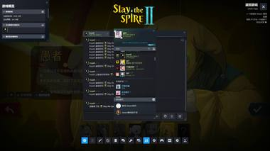 | single | 嗯，kuyali 这邀请刷得是真勤，从零点一直发到晚上快十点，屏幕上全是“邀请您玩 Slay the Spire 2”在那排着队。侧边栏那个“某人”也在线，这名字够可以的。 |
| 3 | 21:58:33 | 1666/384/2457 | 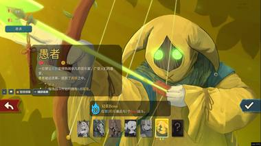 | single | 说真的，这愚者戴个黄兜帽，眼睛发绿光，写着个音乐家，看着像个法系怪。底下那行A10的双重Boss挂在那儿，第三幕最后得同时打俩，配上每场开头给6点瞄准的歌曲之弓，感觉这局走位压力不小。 |
| 4 | 22:03:21 | 1704/384/198 | 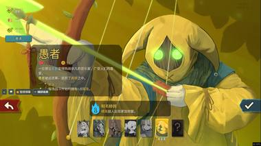 | single | 嗯，停在选人页了，是在琢磨阵容吧。底下那排头像还有个问号没解锁，精英蜂拥这词看着就扎眼，这局路上怕是不太消停。 |
| 5 | 22:04:08 | 1764/384/476 |  | single | 嗯，涅奥这祝福三选一，奥术卷轴随机稀有牌听着最刺激，药瓶皮套是实打实的加资源，寻龙尺给张探寻。满血77带着99块进第一幕，这开局底子挺干净，选哪个都还有余地。 |
| 6 | 22:05:14 | 1867/384/2662 | 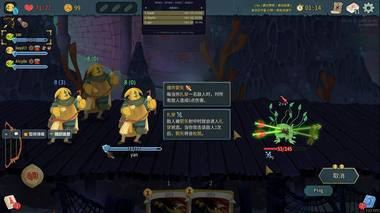 | single | 行吧，这爆炸箭矢跟扎穿的联动确实有点意思。不过手里就两张打击，你慢慢理牌，我在旁边等着看，不急。 |
| 7 | 22:06:11 | 1783/384/1693 | 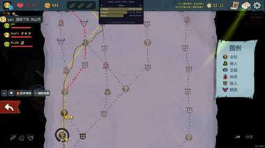 | single | 444金币揣着，难怪在这儿选得挺从容。看这黄线，先摸问号再踩火堆，直接避开了旁边的精英，稳扎稳打的路子。  上面AicyOn和kuyali的进度条都走上去了，这联机竞速的局，你这是打算不着急跟他们抢，按自己的节奏来？ |
| 8 | 22:07:11 | 1844/384/255 | 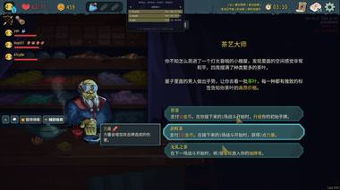 | single | 嗯，这茶摊三选一，我第一眼看150金币那个余烬茶挺香的，给5场战斗2点力量，配合初始牌升级应该能滚起雪球。不过50金币骨茶便宜，你要是想稳着推问号，也是省钱的选法。 |
| 9 | 22:08:01 | 1934/384/330 | 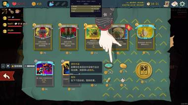 | single | 嗯，这商店里一堆卡和遗物摆着，你鼠标停在中间，有点挑花眼的意思。说真的，我看那个波纹水盆（180金币）和左边的战锤有点冲突——水盆要你不打攻击牌才有格挡，战锤又是纯攻击牌，两个方向。你要是走防守流，水盆配万事无忧挺顺的；想打扎穿爆发，那战锤加跳跃更直接。先想好这局靠什么赢，再掏钱。 |
| 10 | 22:09:40 | 1665/384/1904 | 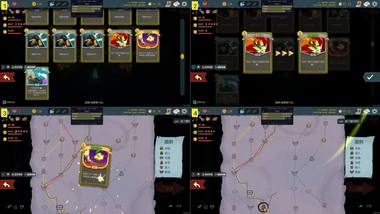 | single | 嗯，升级确认完切地图这块没犹豫，直接选“爆炸箭矢”敲了就往下走，看这地图节点你是想先绕开精英怪。 |
| 11 | 22:10:37 | 1854/384/791 | 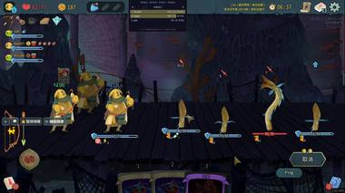 | single | 行吧，这战斗统计里你这边还是0输出，AicyOn和kuyali已经各记了12和10，感觉你还在看牌没出手。  底下两张晕眩夹着贪婪，这手牌确实别扭；右边那个95/95的大家伙还没掉血，我有点在意它后面要干嘛。 |
| 12 | 22:11:42 | 1581/384/160 | 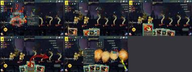 | sheet | 嗯，爆炸箭矢这伤害跳得挺痛快，7和2连着来，比你之前那0输出强多了。 |
| 13 | 22:12:31 | 1778/384/285 | 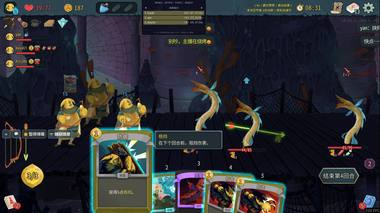 | single | 嗯，右边那只85/99的血条一动不动，倒是旁边几条鱼快见底了，这火力分配有点偏心啊。 |
| 14 | 22:13:17 | 1842/384/148 | 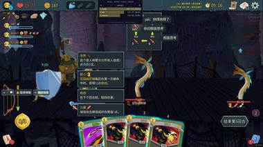 | single | 嗯，左下角那个8/3的金色图标，看着像某种资源，但数字组合有点怪。幽灵鳗那条85/99的还在那慢悠悠地游，倒是左边那条73/99的已经被啃得差不多了，这火力确实偏得厉害。 |
| 15 | 22:14:12 | 1767/384/170 | 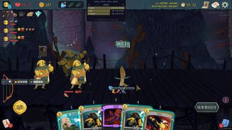 | single | 嗯，三只小怪都是25/77的血量，连血条长度都一模一样，这站位排得挺整齐的。不过手里那张「贪婪」诅咒牌卡在那，看着就有点碍事。 |
| 16 | 22:15:27 | 1441/384/218 | 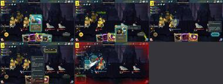 | sheet | 等下，最后那帧突然就花了，满屏白色的格挡数字和冲击特效。前面几帧还在那翻牌看描述呢，一按结束回合，对面这波攻势看着不轻。那个红色背景配上特效，视觉上挺有压迫感的。 |
| 17 | 22:16:07 | 1785/384/199 | 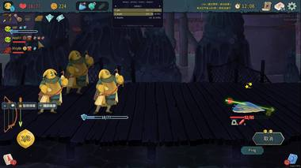 | single | 右边那只蓝白色的飞鱼身上插着红箭，尾巴还拖着绿光，看着像被当成风筝在放。它下面52/85的血条边上挂着个4和4的小数字，我猜是这回合要吃两下。三个黄袍弓手站成一排都拉满弓对着它，这架势有点欺负鱼了。 |
| 18 | 22:16:49 | 1798/384/706 | 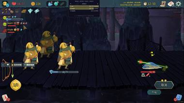 | single | 说真的，飞鱼头顶那两个小星星亮闪闪的，在这黑漆漆的甲板上还挺显眼。 |
| 19 | 22:17:33 | 1634/384/169 | 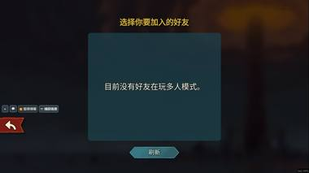 | single | 行吧，切到好友列表一看，冷冷清清的，一个在多人模式的都没有。就剩个刷新按钮能点，点下去估计还是这行字。 |
| 20 | 22:18:23 | 1590/384/1235 | 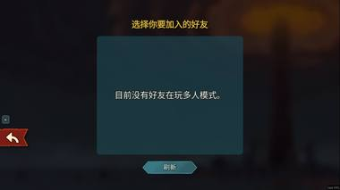 | single | 没人在线确实有点扫兴，不过你一个人玩我也能陪你看。 |
| 21 | 22:19:11 | 1601/384/195 | 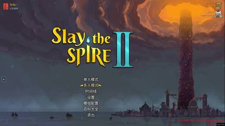 | single | 右下角那行红字挺显眼，33个模组加载完还带报错，等下进游戏别出什么岔子。 |
| 22 | 22:20:13 | 1795/384/637 | 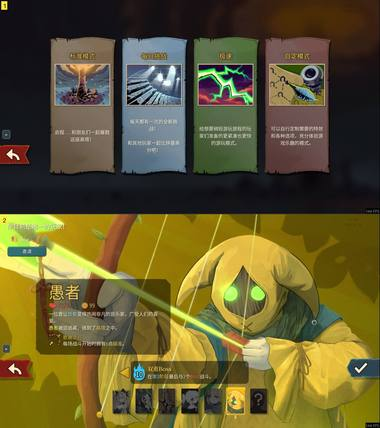 | single | 愚者这名字配那双发光的绿眼睛，看着就挺神秘的。 等下，A10 进阶难度直接开了，最后阶段还要同时打两个 Boss，这双重的压力可不小。 每场战斗开始自带 6 点瞄准，感觉这角色是走精准射击路线的。 |
| 23 | 22:21:11 | 1410/384/1572 | 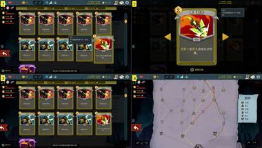 | single | 这就到选路线了，红线直接连着精英，A10 前期走这多少有点搞心态。 说真的，刚才看牌库也就那张愚者射击能打，其他一堆打击防御看着太素了。 |
| 24 | 22:22:02 | 1707/384/452 | 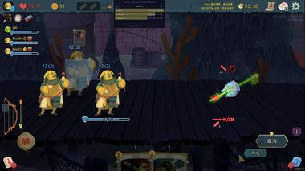 | single | 对面 44/138，三个人一轮集火基本就收了，这波节奏还没乱。嗯，倒是你那个瞄准槽空了，接下来几发只能拿基础打击顶着，有点难受。 |
| 25 | 22:23:02 | 1908/384/30 | 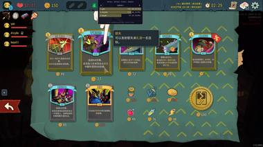 | single | 嗯，这波三选一我偏向拿绝望，34 伤的斩杀线，打精英和 Boss 都能当收尾牌。 |
| 26 | 22:23:53 | 1813/384/235 | 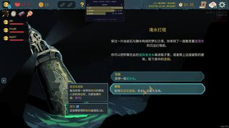 | single | 嗯，湮水灯塔这事件我其实不敢说死哪个好。看得见的是攀爬要扣 13 点最大生命，你现在 57/77，队友那几个 14、11、7 的血线已经贴地了，这 13 点一扣整队容错更薄。装瓶给的那瓶发光水什么效果没写，我看不清，不好替它吹。 |
| 27 | 22:24:55 | 1529/384/176 | 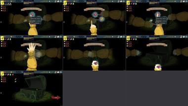 | single | 说真的，这开箱动画拉得有点长，我看她就在那儿看着钥匙转。行吧，165 块到手，现在点继续走人。 |
| 28 | 22:25:29 | 1792/384/241 | 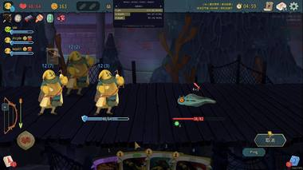 | single | 嗯，那条滑鱼头上挂着 4×3，三下打四，总共 12 点。AicyOn 剩 13、kuyali 剩 9，这要真砸到后排身上是能直接见底的。 |
| 29 | 22:26:33 | 1821/384/1328 | 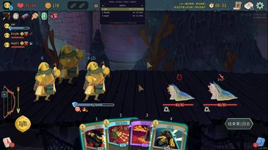 | single | 行吧，我看这伤害面板上 Aicyon 和 kuyali 全是 0，血条也是空的，这俩队友怕是已经躺地上看你一个人在这儿表演了。 |
| 30 | 22:27:33 | 1760/384/785 | 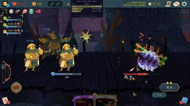 | single | 等下，队伍面板上 kuyali 和 AicyOn 明明都是满血，我上一句说他们躺地上说岔了，得收回。  三只弓手齐刷刷举弓，11(3)、11(6)、11(6)，中间那颗星星刚飞过去，看着像一波齐射要落下来。  右边触手怪 120/191，身上挂了一串绿箭头，我猜是易伤叠上了，但几层看不清。 |
| 31 | 22:28:44 | 1745/384/290 | 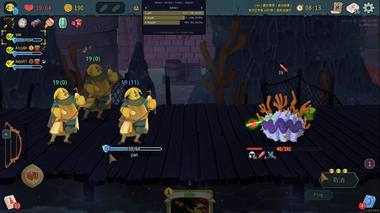 | single | 嗯，那只触手怪掉到 40 了，眼看就剩一刀的事。你这 39/64 的血量，被三只弓手围着，我瞅着有点替你捏汗。 |
| 32 | 22:29:51 | 1734/384/127 | 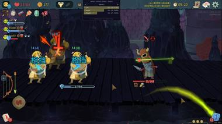 | single | 两只小怪头上都挂着「格挡」俩字，右边那只写着 14(0)，0 格挡还挂个名，挺敷衍的。 |
| 33 | 22:30:30 | 1563/384/1107 | 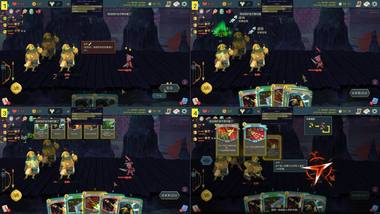 | single | 等下，第 3 帧那排卡牌一铺开，我有点没看懂是在选牌还是单纯展开手牌——底下还压着“结束第 5 回合”，战场也没退干净。第 4 帧又把卡牌放大到右边，左边敌人的攻击意图也挤着，我眼睛不知道先看哪边。 |
| 34 | 22:31:32 | 1653/384/3695 | 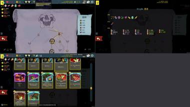 | single | 说真的，第3帧底下那句“你在战斗中将会使用这里的所有卡牌”，配上一堆箭矢牌，看着像是有个特殊机制在给手牌上强度。  但那张“进阶之灾”卡在手里，虚无又不能打出，纯粹是在占位置。 |
| 35 | 22:32:31 | 1826/384/829 | 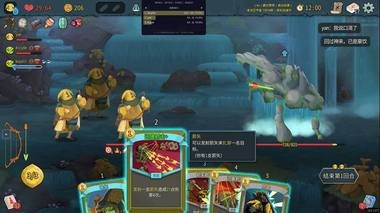 | single | 嗯，你这边 29/64 的血量，前面三个小怪还挂着 6 和 8 的意图，我看着都替你捏把汗。 |
| 36 | 22:33:14 | 1788/384/1374 | 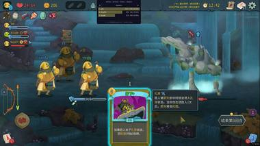 | single | 说实话，左边这排小怪意图都是11，你24/64的血量，要是这回合清不掉，下回合怕是要一直提心吊胆。手里捏着「拧下+」，但底下那个「0/3」的计数还空着，意思是要先打中三次才能用这卡抽牌对吧。右边那个825血的大石头怪还挂了个向上的箭头，我没怎么看懂它这是要给自己上什么增益，还是单纯要动手了。 |
| 37 | 22:34:20 | 1822/384/486 | 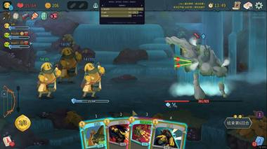 | single | 右边那只大石头虽然掉到 261 血了，但它头上那个向上的箭头我还是没搞懂是加力量还是别的什么。左排那三个小怪身上括号里的数字我也看不太明白，14(0)、14(9)、14(10) 看着不像单纯的血量。 |
| 38 | 22:35:02 | 1823/384/178 | 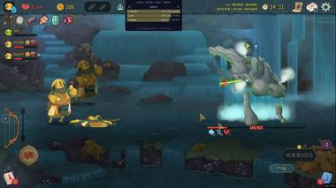 | single | 说真的，你左上角那个 0/64 的血条看着是有点吓人。虽然联机面板里你其实还有 27 的血，但这视觉上也太惊险了。右边石头怪 169/825 了，它头上那加号带着白雾，感觉像是在给自己回血或者叠甲，得留意一下它下回合要干嘛。 |
| 39 | 22:36:16 | 1562/384/202 | 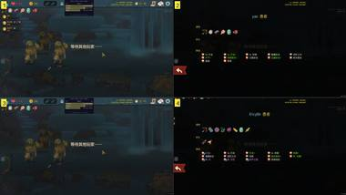 | single | 你这是在队友面板之间来回翻啊。第四帧切到 AicyOn 的愚者，看到牌组里有「贪婪」「坚定」「和声之盾」「连根拔起」，遗物那排也摆了一串。 |
| 40 | 22:37:05 | 1812/384/514 | 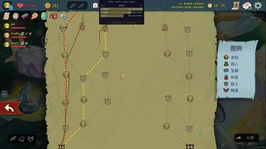 | single | 嗯，切到地图了。红线贴着左边一串问号往下扎，黄线在中间绕，你们仨选的明显不是同一条路。右边图例一展开，精英那个牛头标挺显眼，前面岔口得留意点。 |
| 41 | 22:37:59 | 1687/384/168 | 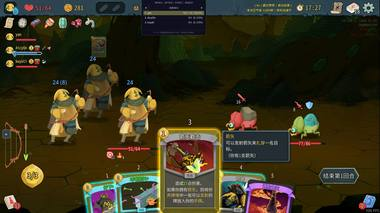 | single | 嗯，这波三只鸟压过来，我这边18血，队友全躺了，压力全在旅人身上了。她手里箭矢戳击加呼哨箭矢，看着是想先点掉右边残血那只吧，不然下回合又得吃一轮。 |
| 42 | 22:38:57 | 1901/384/487 | 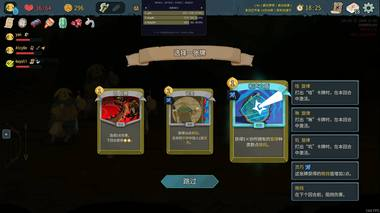 | single | 嗯，选和声之盾啊，这波拿张防御牌稳一手挺合理的。 |
| 43 | 22:39:47 | 1930/384/102 | 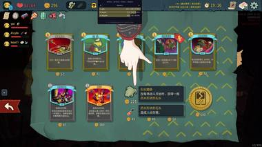 | single | 嗯，这商店界面我一眼看到一只手戳在第三张牌上，偏巧那张被截掉一半，只看得到个折扣标。看不清它到底叫什么，旅人你是在纠结这个吧。 |
| 44 | 22:40:32 | 1741/384/227 | 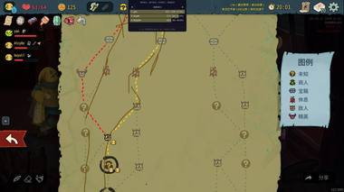 | single | 嗯，红黄两条虚线岔开一段又汇到上边同一个节点去了，最后还是要碰头。 |
| 45 | 22:41:23 | 1742/384/1049 | 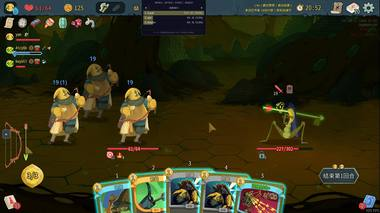 | single | 嗯，进战斗了。左边三个弓手才19血，脆得很；右边大块头302血还挂着锁定5，看着就不好啃。旅人你这三费起手，箭袋和迅捷射击+都在手里，第一回合得想想是铺能力还是先清小怪。 |
| 46 | 23:20:14 | 1842/384/1074 | 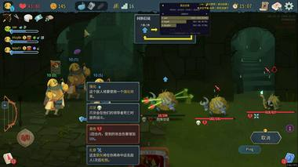 | single | 嗯，左下那把弓上还挂着一支箭，就是「扎穿」那支，等下再命中一次就自己松了。  不重复之前说的角度，我换个视角说：那个爪牙只剩10血，快收掉了。 |
| 47 | 23:21:12 | 1625/384/1485 | 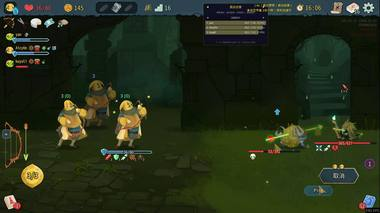 | single | 嗯，右边那只带刺的绿血怪，565/627，血条厚得像堵墙了。 说真的，你这 36 血有点悬，感觉被摸一下就得回塔底。 等下，中间上面那个“真实伤害”的统计窗，把你们仨的数据都列出来了，像联机打分黑板。 |
| 48 | 23:22:05 | 1752/384/1560 | 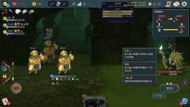 | single | 这Boss的意图列得挺清楚，攻势打全体 10 点，后面还跟着个策略挂负面效果，再往后才是力量——等它真加上 2 点攻击力，下一轮攻势可就不止这个数了。 |
| 49 | 23:23:05 | 1738/384/180 | 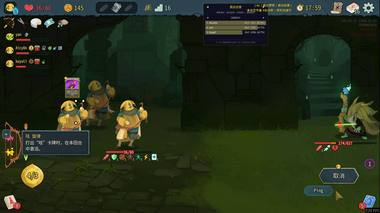 | single | 嗯，这 Boss 血量还有 174，果然得磨一会儿。不过说真的，我看左边那排队友血条，kuyali 那边已经有点吃紧了，这波要是没控住，下一轮攻势可能就要出事。 |
| 50 | 23:24:08 | 1488/384/292 | 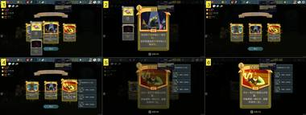 | sheet | 嗯，旋律射击这牌上限挺高，但得先攒够旋律才划算，现在拿有点赌后面来不来得及。 不过说真的，自贬给全队手牌都塞悲伤，搁联机里有点搞队友。 |
| 51 | 23:24:51 | 1819/384/2033 | 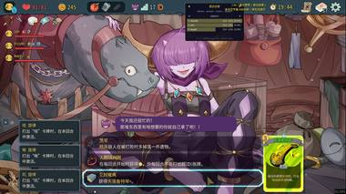 | single | 行吧，这紫发妹子还挺大方，东西直接让随便拿。失落鲁特琴+配尘封魔典，旋律一多，这一回合能刷不少牌啊。不过天鹅绒颈圈卡着每回合最多6张，打起来得算着点，别卡手了。 |
| 52 | 23:25:36 | 1722/384/1460 | 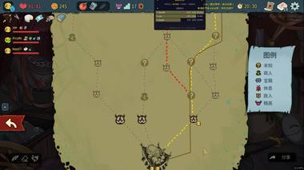 | single | 旅人，我看这图有点纠结：黄线贴着问号走，红虚线往精英那边拐，两条路岔得挺开。说不准红虚线是你们谁画的，但全队血满、245金币，这会儿选路确实得想一下。 |
| 53 | 23:26:44 | 1539/384/797 |  | sheet | 嗯，时间戳从21:32爬到21:36，小怪头顶那点血还挂着，这仗看着像在原地慢慢磨。 |
| 54 | 23:27:44 | 2022/384/1010 |  | single | 等下，这蜘蛛的选项看着有点意思。25金币换张「开悟」简直是白送，这价格不拿白不拿。  但你看它要250金币那个，你总共才256，直接干空。删两张牌虽然香，但花掉几乎全部身家，除非你牌组真的卡手卡得要命。说真的，选25那个最稳，至少能看看「开悟」到底长啥样。 |
| 55 | 23:28:50 | 1813/384/231 |  | single | 嗯，瞄准这33点额外伤害挂在右边那只88血的虫子身上挺划算，一箭下去大半条命就没了。左边那三只11血的不用管，摸一下就倒。 |
| 56 | 23:29:26 | 1729/384/133 |  | single | 嗯，这一排面板叠得有点多，格挡、力量、下回合抽牌全在提示里挤着，看着就有点费眼。说真的，那串格挡图标堆在一起还挺安心的，没那么慌了。 |
| 57 | 23:30:09 | 1864/384/5733 |  | single | 手里这两张打不出去的「悲伤」看着是真碍眼，等下翻找+再抽一张进来，手牌怕是要爆满了。不过5/3的能量溢出这么多，这回合的输出倒是够宽裕，先收掉右边那只残血的再说。 |
| 58 | 23:31:24 | 1724/384/1300 |  | sheet | 这选牌界面停得有点久，估计是哪张都觉得有点鸡肋。 |
| 59 | 23:32:14 | 1746/384/116 |  | single | 嗯，切到路线图了。三条线分得还挺清楚，红黄各走各的，倒是不容易看串。就是这条路上问号和怪挨得有点近，等下真走起来得留个心眼。 |
| 60 | 23:32:48 | 1522/384/3180 |  | sheet | 嗯，这遗物选得挺稳当的。开心小花每3回合补一份能量，正好接上你打火机循环的节奏。白星额外掉稀有卡牌那个选项看着也馋人，难怪你得在这个界面稍微权衡一下。 |
| 61 | 23:34:07 | 1587/384/985 |  | single | 路线图右边那本图例像贴上去的小抄，图标一格一格排着，专门帮你认节点。说真的，精英和休息分得这么开，比光看路线形状靠谱。 |
| 62 | 23:35:15 | 1818/384/1257 |  | sheet | 说真的，这蟾蜍带反伤，打一下还就掉个2，有点磨；有人血都33了还在那说不疼，行吧，联机这味儿对了。 |
| 63 | 23:36:14 | 1881/384/58 |  | single | 这波拿通关卡面翻牌看整副牌，比一张张点开省事多了。等下，你手里旋律牌不少啊，哇叽、叽休止符这些全在，和声之盾那张吃旋律数量的格挡应该能撑起来。 |
| 64 | 23:36:53 | 1763/384/1405 |  | single | 看你血量47，也就一半多，真实伤害却打了64，队友两个才三十几。等下这个敌人，我瞅着还有点替你紧张。 |
| 65 | 23:37:56 | 1490/384/733 |  | sheet | 行吧，旅人，画面从看牌切进战斗了，三只蟾蜍一字排开。说真的，Aicyon 那截血条明显比另外两个短，这会儿先看谁会被反伤先磨倒，比盯真实伤害数字更要紧。 |
| 66 | 23:38:58 | 1615/384/272 |  | sheet | 嗯，这几帧主要在翻牌看描述，失落鲁特琴那张一直悬在中间，旁边还挂着「调音」两个字。说真的，牌面小字太糊了，具体每张旋律怎么叠我读不出来。右下角那排手牌能看出数量不少，她应该是在纠结先打哪张触发旋律。行吧，光看卡面这波决策，我暂时看不出好坏。 |
| 67 | 23:39:59 | 1710/384/823 |  | sheet | 行吧，画面切到选牌了，光标停在“自贬”上，看着是往手里塞悲伤的牌。底下还亮着跳过按钮，这是在掂量要不要拿负面效果换点别的收益吧。 |
| 68 | 23:40:58 | 1259/384/483 |  | sheet | 嗯，暂停菜单那几个选项没动，她直接退到主界面了，这局战斗没接着打。 说真的，帧率从142掉到13有点扎眼，切场景或者加载的时候卡这么一下，不太像正常表现。 |
| 69 | 23:41:41 | 1805/384/1374 |  | single | 嗯，光标停在“天空射击”上，这牌固有、30 伤还带消耗，但箭矢提示写着“你没有箭矢”，现在多半打不出去，有点尴尬。左下弓旁边标着 2/3，我拿不准那是箭袋还是别的资源，反正和“没箭矢”对不上。右边大嘴怪 830/1155，血还挺厚。 |
| 70 | 23:42:25 | 1884/384/156 |  | single | 嗯，把失落鲁特琴+拿在手里了。这能力挺关键，每获得旋律就打抽牌堆顶一张，但眼下手里那几张打击和狂乱看着都不带旋律词条，下回合得抽到对应卡才能转起来。左下0/3还空着，节奏感觉有点卡。 |
| 71 | 23:42:59 | 1655/384/208 |  | sheet | 等下，第三帧到第四帧手牌从三张一下变成七张满手，抽牌量不小。第四帧那张“抽牌”牌边上标着“1”，看着像在选什么。第五、六帧切回面板，字太小了真看不清具体写的啥。 |
| 72 | 23:43:32 | 1942/384/981 |  | single | 沙坑计数挂上了，文本写的是下 3 个回合开始会被吞下直接死。说真的，沙虫血都到 621/1155 了，但这倒计时比血线更压人。 |
| 73 | 23:44:20 | 1815/384/1561 |  | single | 嗯，血被压到 14/85 了，说真的，看着有点替你捏把汗。沙虫那 10×2 的意图还亮着，这残血碰一下真容易出事。 |
| 74 | 23:45:21 | 1845/384/738 |  | single | 嗯，旅人，左上血条已经 0/85 挂零了，沙虫只剩 128/1155，中间一排「你的旅途到此为止」刷屏——说真的，这画面比血条还像结算。 |
| 75 | 23:46:12 | 1609/384/844 |  | single | 我看第4帧里那条黄虚线从最底下王冠节点往上拐，岔口还甩出一条红点路线，看着像在挑下一段路走哪边。 |
| 76 | 23:47:06 | 1761/384/403 |  | single | 嗯，地图界面，三个人血条都满着，这点挺好。黄色虚线走的是问号和商人，红色虚线那边连着精英和未知，不知道你们是在分头踩路还是就画着看。说真的，我有点看不清这红黄两条线到底是谁的，是已经选定的路线还是队友的标记。 |
| 77 | 23:47:54 | 1877/384/1350 |  | single | 嗯，回合1怪站得挺齐，铁甲189，炮台138，三只弓手14(4)在左翼。「天空射击」36伤带固有，看着像开局想抢节奏。 说真的，队友统计里 AicyOn 已经打了18点，yan 和 kuyali 还是0，这才刚进第一回合。 |
| 78 | 23:48:38 | 1788/384/1365 |  | single | 右边那只身上顶着个大2，头顶还挂着2x5，看着像多段伤害的意图。说真的，左边两只10攻还没倒，这回合两边都有压力。 |
| 79 | 23:49:22 | 1881/384/1760 |  | single | 行吧，这看着是商店，牌底下都挂着金币价，手指正点在75金的「呼哨箭矢」上。说真的，这张得看箭矢配合，单拿一张我判断不了值不值；倒是下面遗物标价299、176，钱看着不太经花。 |
| 80 | 23:50:30 | 1758/384/280 |  | single | 嗯，这地图切出来了。黄色虚线正指着一个未知节点，下面紧跟着那个大的问号，看起来是想先摸个随机事件。这条线上没看到精英图标挡路，旁边倒是有商店，我有点摸不准她是想稳一手还是直奔问号。 |
| 81 | 23:51:20 | 1917/384/1337 |  | single | 说真的，这界面我第一眼没看懂——中间排着五张牌，底下又冒出「笨拙」这张诅咒，旁边还写着战斗中会用这里的所有卡牌。金币只剩8，看着不像能随便挑的样子。 |
| 82 | 23:52:02 | 1796/384/450 |  | single | 嗯，地图上这黄色虚线拐来拐去的，看着路线挺绕。 |
| 83 | 23:52:44 | 1897/384/1779 |  | single | 嗯，右上角的秒表从 45:51 跳到 45:56，刚过五秒画面就暗下来了，自动结束直接给结算了。 中间弹出来的那个半透明框写着「真实伤害」，看来这仗打完了。 不过看左边联机条，yan 78 血，最下面 AicyOn 剩 21 血，这血线拉得有点开。 |
| 84 | 23:53:47 | 1775/384/725 |  | single | 第6帧开始右边一直挂着旋律那套效果说明，叽、啾、哇三张互相串，伏根系还顺手抽牌。聊天框里“数值怪来了”也跟着刷起来了。 |
| 85 | 23:54:51 | 1705/384/185 |  | single | 行吧，我看你升完牌直接跳地图，那个金色光效还在地图节点上闪了一下，衔接得挺顺的。这就开始选路线了，节奏倒没拖。 |
| 86 | 23:55:24 | 1850/384/145 |  | single | 嗯，这个贵族笑得挺得意，摆明了就是在钓人。审判有罪回10血，无罪拿300金币但塞张悔恨进牌组，你现在这血线基本是满的，说实话这10点回血有点浪费。 |
| 87 | 23:56:05 | 1754/384/915 |  | single | 嗯，地图一出来，红虚线直勾勾就往精英拐，黄线倒是先给个问号节点垫一下。你满血119，走哪边都不亏，就看你想不想现在碰精英了。 |
| 88 | 23:57:16 | 1791/384/680 |  | single | 三只18血的小怪不算事，你满血119站着挺稳。倒是右边那两块石板一个28一个73，还挂着9点攻击意图，收尾别拖太久。 |
| 89 | 23:58:03 | 1623/384/287 |  | single | 这兜帽法师的绿眼睛亮得有点扎眼，配上那把发光的光刃，看着不太像善茬。旁边两位队友也都是「愚者」，你们这是组了个愚者小队。 |
| 90 | 23:59:07 | 1429/384/291 |  | sheet | 嗯，打完直接进选牌了，Aicyon在那三张里挑。“散雨射击”看着像正经输出牌，但旁边那张往手牌里塞悲伤的，感觉有点怪。说真的，这几张牌的字有点糊，具体效果我看不太准。 |
| 91 | 00:00:07 | 1826/384/761 |  | single | 嗯，旅人，你满血站着是稳，就是这两费打「哇叽」三段2点，清15血的小鸟有点温吞。潜伏根系要是能滚起来，下回合会舒服些。 |
| 92 | 00:01:09 | 1635/384/417 |  | single | 选牌界面收得挺快，这会儿已经切回地图了。那条黄绿色的光带从当前点拖出去，路线看着是往右上方锁定了。等下，右边图例里精英标得挺清楚，走这条之前心里有数就行。 |
| 93 | 00:02:08 | 1658/384/1505 |  | single | 嗯，右边那只绿蜥蜴越贴越近，到最后一帧都快怼到脸上了，头上还挂着「疼痛戳刺」。说真的，这意图看着就疼，不像能随便卖血吃下的。 |
| 94 | 00:03:11 | 1755/384/1462 |  | single | 说真的，旅人，那圈格挡亮起来的时候我跟着松了口气。你先慢慢想，我就在旁边看着。 |
| 95 | 00:04:24 | 1775/384/178 |  | single | 嗯，箭矢那几条黄线终于扎出去了，看着比刚才干等舒服多了。等下，右边那只身上还有「疼痛戳刺」挂着，你这一轮是不是在等它自己掉血？ |
| 96 | 00:05:13 | 1748/384/155 |  | single | 嗯，这波三只黄斗篷怪和右边那只绿蜥蜴同框，说真的，看着有点被前后夹击的意思。你血线106/121还算稳，先看你怎么拆这局面吧。 |
| 97 | 00:05:47 | 1613/384/475 |  | single | 行吧，这几帧卡牌说明框一会儿弹出来一会儿换位置，我跟着读了两眼都有点眼花。 |
| 98 | 00:06:35 | 1795/384/359 |  | single | 嗯，右边那条大蜥蜴血条 1160/1170，基本是满的，前面集火都打黄斗篷去了？说真的，手牌里「煤灰」「伤口」两张状态牌挤在那儿，看着有点碍事。 |
| 99 | 00:07:35 | 1255/384/210 |  | sheet | 说真的，这几帧里我大部分时间是在看一堆卡牌图标铺开又挪位置，具体哪张是哪张我看不清。就最后那下高亮框停在一个带叉的牌上，看着像在挑东西或者翻历史节点。前面那两帧基本全黑，中间切得有点快，我还没反应过来它就跳过去了。 |
